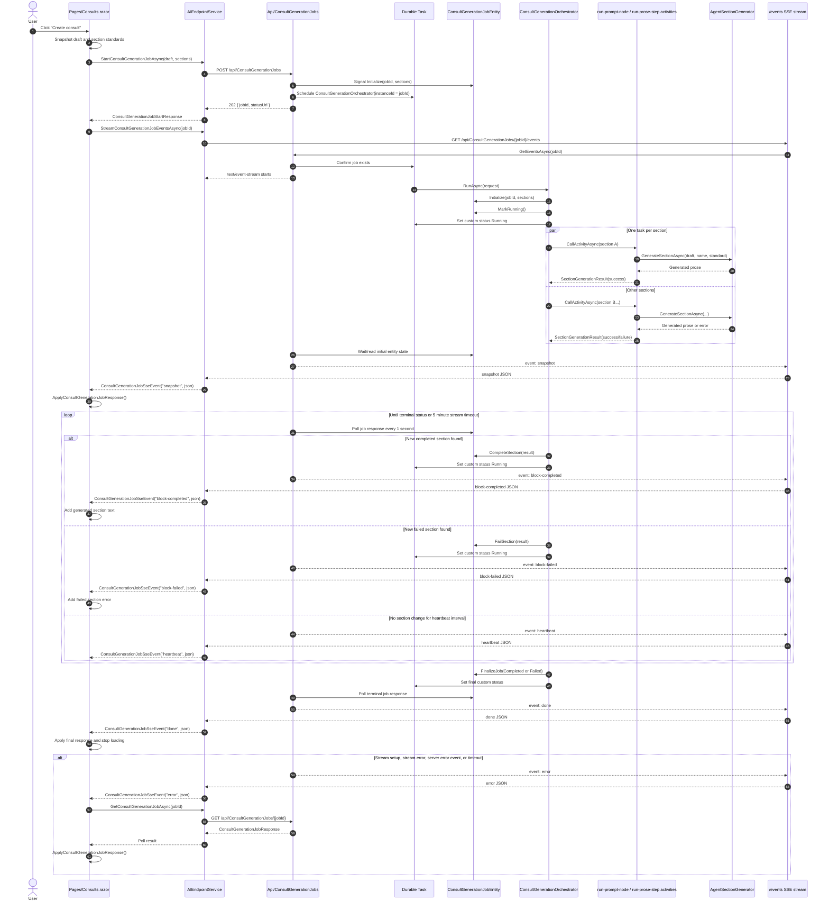

# Consult Generation Event Flow

> **Updated for Milestone 5 (2026-07-15)**: the engine executes one node kind with
> per-(node, item) scheduling. The event *surface* is unchanged — `node-completed`
> fires per node-level completion (a forEach node completes when its last item
> settles), and `item-step` events are synthesized from per-item node
> completions with identical payloads (step ids = the forEach chain's node ids).

This is the current consult generation flow after the .NET 10 SSE migration.

## Event Contract

The `/events` endpoint emits these server-sent event names:

- `snapshot`: initial public `ConsultGenerationJobResponse` — nulls omitted and `HeldInputs` an empty map when the job holds inputs (#1051: the input text never rides an event; History reads it through GET).
- `node-completed`: one DAG node's completion (or the map node's start), with
  `JobId`, `NodeId`, package-declared `Label`, `Message`, and node counts
  (milestone 4; replaces the fixed analysis stage events).
- `item-step`: per-item chain progress with the step id, package-declared
  `Label`, `Message`, and step counts (milestone 3; replaces the fixed step-named
  events).
- `block-completed`: one completed block with `JobId`, `BlockId`, and generated `Text`.
- `block-failed`: one failed block with `JobId`, `BlockId`, and `Error`.
- `block-skipped` (v27, #1235): one block skipped by condition — an `if`/`case` inside a loop took no branch for the item — with `JobId`, `BlockId`, and `Reason` (the condition's text, never a value); counted among the completed blocks, no text.
- `heartbeat`: stream keepalive with `JobId` and current `Status`.
- `done`: final public `ConsultGenerationJobResponse`, the same way (nulls omitted, `HeldInputs` emptied).
- `error`: stream-level failure with `JobId` and `Error`.

Legacy event names (`analysis-started`, `concepts-extracted`, …,
`section-standard-draft-created`, …) are never emitted for new jobs but replay from
the event store for jobs that ran before milestones 3–4; the client ignores them.

Semantic events include persisted `id:` values in the form `{jobId}:{sequence:D12}`. Heartbeat events are not persisted and do not advance the semantic event sequence. #1051: when the store refuses a response's events (a payload past what a row holds, storage down) the stream still sends them, **without `id:`** — they cannot be resumed by `Last-Event-ID` — and always sends `done`; the client treats such a stream exactly as a live one.

The Blazor page treats `snapshot`, `node-completed`, `item-step`, `block-completed`, `block-failed`, and `done` as live UI update events. It falls back to polling `GET /api/ConsultGenerationJobs/{jobId}` when stream setup fails, the stream times out, the stream ends before `done`, event handling fails, or the server emits `error`.
