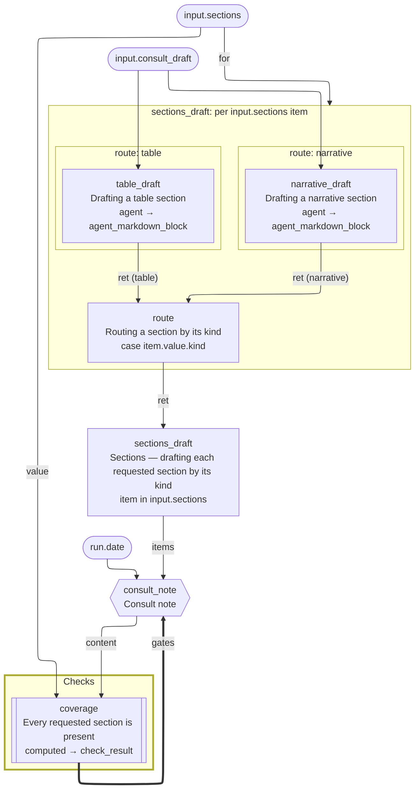
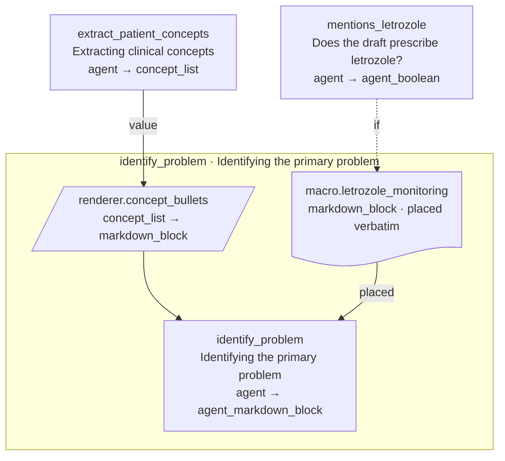
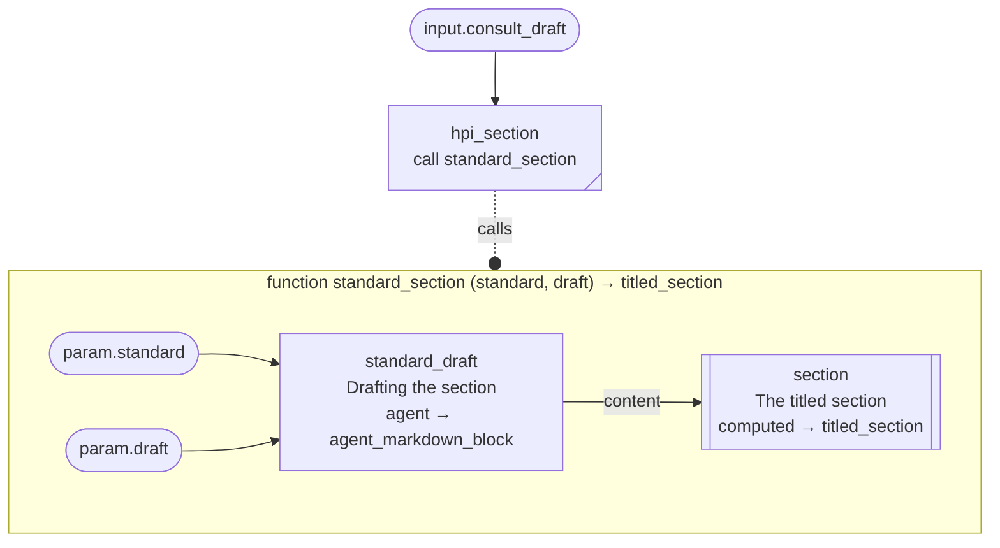

# 09. The engine and the pages

This part covers what ships beside the grammar in the same release: how the engine loads and
schedules a 31 package (#1389, #1393), the dev preview setting (#1447), the
`WorkflowPackages/Current` contract the satellites read (#1385, #1447), the Create, History and
Profile pages (#1406, #1408, #1395), the Editor, which shows 31 packages read-only until
Milestone 41 (#1447), and the diagram: `dag.mmd`, the Editor's Graph pane and the run diagram
(#1398). The grammar these rely on is in parts [01](01-files-and-scopes.md) to
[06](06-checks-deliverables-profile.md), the compiled documents in [07](07-compiled-documents.md),
and the record's shape in [08](08-record.md).

## 1. Loading a package

### 1.1 Two load paths, chosen by `specVersion`

| Spec version | What the engine reads | Until |
|---|---|---|
| 5–30 | today's path: `manifest.json` and the source files, materialised and validated per load (`WorkflowPackageStore`) | retirement, #1450 (Milestone 40) |
| 31 | **only `resolve.json`** from the published version's folder in the registry | — |

- **No backfill.** Versions published before 31 never get a `resolve.json`; they keep today's path
  until they are retired. Packages that must keep running are migrated, which gives them a real
  `resolve.json` and `lock.json` ([correction](https://github.com/Consultologist/Consultologist-Blazor/issues/1389#issuecomment-6904042859)).
- **The engine never reads a 31 package's source tree** at job time. Bodies are inline in
  `resolve.json`, so one document and one hash cover everything
  ([decided](https://github.com/Consultologist/Consultologist-Blazor/issues/1389#issuecomment-6957667030)).
- **`lock.json` is not needed to run.** The engine reads its hash (to record it) and nothing else;
  the exact versions it holds are for provenance and for the library-upgrade rule (#1390).

### 1.2 The load, step by step (31)

1. **Resolve the pin** to a `name@version`, as today (`WorkflowPackagePinResolver`).
2. **Read `resolve.json`** and **`lock.json`** from the version's folder.
3. **Check the hash.** The SHA-256 of `resolve.json`'s bytes (canonical, RFC 8785) must equal
   the hash published for that version. A mismatch refuses the load
   ([decided](https://github.com/Consultologist/Consultologist-Blazor/issues/1389#issuecomment-6898433175)).
   Where the published hash is kept is part 07's (the version's stamp).
4. **Check `requires`** against this engine: `spec`, `evaluator`, `scriban`, each operation's range,
   `kinds`, `features` and `agents`. Ranges are caret ranges set by the registry (#1390); the
   engine refuses only outside a range. An unknown kind or feature is outside every range.
5. **Build the in-memory plan:** the parsed graph, the compiled JSON Logic, the parsed Scriban
   templates and the resolved formats. **The plan is never stored;** it is derived
   deterministically from `resolve.json` and cached in memory per `name@version`, keyed also by
   the `resolveHash` ([stages](https://github.com/Consultologist/Consultologist-Blazor/issues/1389#issuecomment-6898433175)).
6. **At job start,** check `needs.profile` and, when the package reads `run.date`, the account's
   time zone (§ 5.2). Then record `resolveHash` and `lockHash` beside the package name and
   version, before any node runs.

A refusal at steps 3 or 4 is a start failure: no node runs, and the job's record holds the
sentence. The Create page checks steps 4 and 6 before submission (§ 5.3), so in practice the
clinician sees the sentence there first.

### 1.3 Which spec versions an engine admits

- **The compiled-in list** stays `WorkflowPackageValidator.AcceptedSpecVersions` (publish) and
  `WorkflowPackageStore.SupportedSpecVersions` (load), 5–30 today. **31 joins both lists only at
  the bump** (index § 5, step 4), released after a drain.
- **Before the bump, the preview setting admits 31 on dev alone** (§ 2).
- **Production without the setting** answers a 31 publish or load with today's sentence:
  *"specVersion 31 is not supported: this engine accepts specVersion <list> (pre-v5 packages are
  archived; see registry-operations.md)."*

## 2. The dev preview setting and dev's registry

Decided on [#1447](https://github.com/Consultologist/Consultologist-Blazor/issues/1447#issuecomment-6957669427):
31 is proven on `canada-east-ai-function-dev` first, with dev's own package registry, and
production's registry never sees a 31 package until the bump.

### 2.1 `WorkflowPackages__PreviewSpecVersions`

| | |
|---|---|
| **Type** | a comma-separated list of integers, for example `31` |
| **Unset or empty** | no preview versions: only the compiled-in list is admitted. This is production's value, always |
| **Effect** | each listed version is admitted **beside** the compiled-in list, everywhere a version is checked: publish, import, load, job start, `WorkflowPackages/Current` |
| **Allowed values** | only versions this build implements but has not yet released. In Milestone 39 that is `31` alone |
| **Set on** | `canada-east-ai-function-dev` only |
| **Removed** | at the bump, when 31 joins the compiled-in list |

- **A listed version this build doesn't implement** stops the host at startup, naming the
  setting and the value: **Proposed** (a typo must not silently admit nothing, and an
  unimplemented version must never be admitted).
- **The engine attestation** (`EngineAttestation`) lists preview versions separately, as
  `PreviewSpecVersions`, beside `AcceptedSpecVersions` and `SupportedSpecVersions`, so an
  attestation never presents a preview version as released: **Proposed**.

### 2.2 Dev's own registry

- **Dev's registry lives in `consultdevcaeast`.** Today dev isolates its storage there but reads the
  shared public registry (`consultpubcaeast`); for Milestone 39, dev's `WorkflowPackages__*`
  settings (the private and public blob service URIs) point at containers in `consultdevcaeast`.
- **What dev's registry holds:** the format spec, agents catalogue and provenance releases (index
  § 5, step 1), the example packages at 31, and copies of account packages for the dry run, all
  with fictional content only. **Proposed:** the catalogues are copied into dev's registry from
  the same release tags production uses, and the example packages are published to it through
  `WorkflowPackages/Publish` from the migration branch, not by the public repository's tag CI
  (which publishes to production).
- **Smoke runs and the migration's dry run** happen on dev with fictional inputs. Dev's
  `Diagnostics__LogPromptText=true` stays a dev-only switch, as today.

## 3. Scheduling

### 3.1 What runs when

The orchestrator runs the plan's graph as today: a node is ready when everything it reads has
settled, loops fan out per item, `while` runs pass by pass, branches decide before their bodies.
What changes at 31:

- **The order comes from `resolve.json`** (`graph.order` and the edges), not from walking the
  manifest.
- **`computed` nodes, conditions and checks** run in the orchestrator through the JSON Logic
  evaluator (part 03), with no activity and no model call. **Proposed:** they are evaluated inline
  in the orchestrator, as a deterministic function of recorded values, so replay reproduces them;
  `rendered` nodes and deliverables render in an activity, as templates do today.
- **A `call`** runs as a Durable sub-orchestration per call (#1419), with its own rows (part 08).
- **Check loops** are scheduled per item, as soon as their production item settles (#1396), not
  after the whole production loop.

### 3.2 The per-job ceiling

Decided on [#1393](https://github.com/Consultologist/Consultologist-Blazor/issues/1393#issuecomment-6904683179),
option D.

- **An engine setting, not part of the format.** At most *N* agent calls are in flight for one
  job at any moment. The default is **16**.
- **Setting name: `ConsultGeneration__MaxAgentCallsPerJob`**, an integer from 1 upward; unset means
  16: **Proposed** (the decision names the value, not the setting).
- **What counts:** every agent call (a node of kind `agent`, including a classifier that decides a
  macro's `if`). Calls inside nested loops, inside function calls
  ([#1419](https://github.com/Consultologist/Consultologist-Blazor/issues/1393#issuecomment-6897233461))
  and inside check loops all count the same way. A repair retry (`onInvalid: retry`) and a 429
  retry occupy the same slot as the call they repeat. `computed`, `rendered`, conditions and
  deliverables take no slot: they call no model.
- **With `maxParallel`:** each loop's `maxParallel` still limits its own items, **per loop
  instance**, so nested caps multiply. The effective limit on any one call is the smaller of the
  caps along its nesting path and the per-job ceiling. `maxParallel` is 2–15, or `null` for no cap
  of its own (`FormatBounds.parallel`, part 01), in which case only the ceiling applies.
- **Which call waits when the ceiling is reached: Proposed.** Ready calls are dispatched in a
  fixed order: by the node's position in `graph.order`, then by item path (outer items first,
  then list order), then by pass. A freed slot goes to the first waiting call in that order. This
  keeps dispatch deterministic, so Durable replay and the record agree. The order of completion
  still depends on the model.
- **Implementation:** a counter of in-flight agent calls kept in the orchestrator's state, checked
  before each dispatch. Durable fan-out today dispatches every ready activity at once
  (`ConsultGenerationEngine`'s pending-task loop); at 31 it dispatches only up to the free slots
  and waits on `Task.WhenAny` for the next free one.
- **The record** holds the ceiling in force at job start, once, in the job header; the peak
  concurrency actually reached goes to telemetry only: **Proposed** (#1393 question 6 was left
  open).
- **Applies to 31 only: Proposed.** Packages at 5–30 keep today's scheduling, so the old path is
  unchanged until it retires.

### 3.3 Deployment-wide limits

There is **no shared counter** across jobs. Deployment-wide limits come from host configuration,
sized to the model deployment's quota
([decided](https://github.com/Consultologist/Consultologist-Blazor/issues/1393#issuecomment-6904683179)):

- `host.json` gains `extensions.durableTask.maxConcurrentActivityFunctions` (today unset, so the
  default applies per instance);
- the Flex Consumption app's maximum instance count is set so that instances × activities stays
  within the quota.

The values are deployment configuration, recorded in `docs/` beside the deployment notes, not in
this design. **Option C** (a per-deployment Durable entity counting calls across jobs) is kept for
later, if fairness across accounts needs exact control.

### 3.4 429 responses

- **A 429 from the model deployment is retried with back-off,** and never fails a job for capacity
  alone. A throttled job is slower.
- **Recorded as retries on the node's row** (part 08): each retry's time and the wait applied. No
  model text is involved.
- **The back-off: Proposed.** Honour the response's `retry-after` (or `retry-after-ms`) when
  present; otherwise exponential from 5 seconds, doubling, capped at 60 seconds, with jitter. 429
  retries don't use up the activity's existing failure retries (three attempts today,
  `AgentActivityRetryOptions`), which remain for other failures. There is no retry limit for 429
  alone; the job's existing overall timeout still applies.

### 3.5 The publish note

At publish, when a package's nested caps multiply past the engine's per-job ceiling, the publish
report carries a **note**, never a refusal. The worst case is computed from `resolve.json`: the
product of `maxParallel` along each nesting path (a `null` cap counts as the list's bound, and an
unbounded list as the ceiling), summed over branches that can run at the same time.

> *"Up to <n> agent calls could run at once; this engine runs at most <ceiling> per job, so the
> rest wait their turn."*

The ceiling quoted is the publishing engine's setting. A package valid on one deployment is
valid on every deployment; only the note's numbers differ.

## 4. The satellites' contract: `WorkflowPackages/Current`

### 4.1 The rule

`GET WorkflowPackages/Current` is the **only** contract the Copilot agent
(`consultologist-copilot-agent`) and the Zoom app (`consultologist-zoom-app`) read, and it
**changes by addition only**
([decided](https://github.com/Consultologist/Consultologist-Blazor/issues/1385#issuecomment-6957666238),
[#1447](https://github.com/Consultologist/Consultologist-Blazor/issues/1447#issuecomment-6957669427)).
A satellite built for 30 keeps working against a 31 package: every member it reads today means
what it meant. The satellites are updated before the cutover to read the new member, so they
work with both 30 and 31.

The Copilot agent mirrors `WorkflowPackageResponse(Name, Version, SpecVersion, Inputs, Macros,
Title)` and the input, field and element records
(`src/Consultologist.CopilotAgent.Core/Engine/EngineDtos.cs`), and builds Teams intake cards from
`Id`, `Label`, `Required`, `Type`, `Values`, `Items` and `Fields`.

### 4.2 The response at 31

| Member | At 5–30 | At 31 |
|---|---|---|
| `Name`, `Version`, `SpecVersion`, `Title` | as today | as today; `SpecVersion` is `31` |
| `Blocks` | the top-level blocks | **Proposed:** one per top-level node of `resolve.json`, in `graph.order`: `Id` the node's qualified key, `Name` its `label` |
| `Inputs` | as today | each input mapped into today's fields (§ 4.3), **plus `Format`** |
| `Results` | the deliverables | one per deliverable file: `Id` and `Label` from its header |
| `Macros` | the optional macros, or `null` when none | **always `[]`**: 31 has no per-run macro choices; they migrated to optional boolean inputs (#1412, #1447) |

### 4.3 Inputs at 31

The input record gains one trailing member; every existing member is filled:

```csharp
public sealed record WorkflowPackageInputResponse(
    string Id, string Label, bool Required,
    string? Type = null, IReadOnlyList<string>? Values = null,
    WorkflowPackageElementResponse? Items = null,
    IReadOnlyList<WorkflowPackageFieldResponse>? Fields = null,
    JsonElement? Format = null);   // new: null below 31
```

| Existing member | Filled at 31 from |
|---|---|
| `Id` | the input's key in `manifest.json`'s `inputs` object |
| `Label` | its `label` |
| `Required` | its `required` |
| `Type` | its format, mapped: any text format (`plaintext`, `markdown_block`, `markdown_inline`) → `text`; `string` with `oneOf` → `enum`; `string` without → `text`; `date` → `date`; `boolean`, `number` (and `integer`) → their names; an object → `object`; an array → `array` |
| `Values` | for an enum, the `const` of each `oneOf` entry, in order (titles are in `Format`) |
| `Items` | for an array, its `items` mapped the same way, at every depth |
| `Fields` | for an object, one per entry in `properties`, in written order: `Id` the property name, `Label` its `title` (the property name when there is none), `Required` as part 02 defines a required field, the rest mapped the same way |
| **`Format`** (new) | the input's format as `resolve.json` holds it: a JSON Schema in the dialect, with its `$id` URN and its `$ref`s resolved within the document. `null` for every package below 31 |

- **Inputs come in written order,** which is the Create page's order (#1385).
- **Not added: Proposed.** `description` and `channel` are not exposed in Milestone 39; the
  decision adds `format` alone. A satellite that wants them reads `Format`'s annotations or waits
  for a later addition.

### 4.4 What a satellite can't show

A satellite that meets an input it can't render (for example an inline object schema it doesn't
support, or an input whose only practical filling is a document upload) doesn't start a job. It
shows, with a link to the Create page for that package:

> *"This workflow needs the web app"*

The satellites' own work (reading `Format`, the fallback, releases) is filed as issues in their
repositories and linked from the build parent issue (#1447). The SMART panel and the email intake
are checked against the same contract.

## 5. The Create page

### 5.1 Inputs

The Create page draws a 31 package's inputs from their formats
([widgets](https://github.com/Consultologist/Consultologist-Blazor/issues/1398#issuecomment-6878756627),
[grammar](https://github.com/Consultologist/Consultologist-Blazor/issues/1385#issuecomment-6919612460)),
in written order, each with its `label` and its `description` as help text:

| Format | Widget |
|---|---|
| `string` | a single-line field |
| `string` with `oneOf` | a select showing each entry's `title`, sending its `const` |
| `plaintext` | a text area |
| `markdown_block` | a rich-text editor, stored as Markdown |
| `markdown_inline` | a single-line rich-text field, stored as inline Markdown: **Proposed** |
| `date` | a date picker |
| `boolean` | a checkbox, unticked to start; an optional boolean left unticked is sent as `null` (not given), which `=== true` reads as false and `!== false` reads as true: **Proposed**, matching how per-run macro choices migrate (#1412) |
| `number`, `integer` | a number field |
| an object | a field group, one field per property, by the same table, to any depth |
| an array | repeating rows of its `items` |

- **Documents need no member.** Any text-format input takes typed text or a document; an array of
  text takes typed rows, documents and earlier runs' deliverables in the order sent (#872, #874,
  #1144), as today. A document sent to a Markdown input is converted to Markdown, and the
  converter's, parser's and OCR's versions are recorded with the input
  ([decided](https://github.com/Consultologist/Consultologist-Blazor/issues/1389#issuecomment-6924904289)).
- **`channel`** (`transcript`, `image`, `ambient-note`, `form`) does what `expectedContent` does
  today; only the name changes.
- **No macro panel** for a 31 package: its per-run choices are ordinary boolean inputs.
- **Personal snippets** are inserted into inputs as today; they are never `profile.*` reads.

### 5.2 The signature choice

- **Shown only when the account has more than one signature block**
  ([decided](https://github.com/Consultologist/Consultologist-Blazor/issues/1408#issuecomment-6957668236)),
  and only when the package reads `profile.signature` (it is in `needs.profile`): **Proposed** for
  the second condition.
- **Defaults to the account's chosen block** (`ChosenId`). The pick applies to this job only and
  never changes `ChosenId`.
- **The record names the block's id,** never its text (#1408).

### 5.3 Checks before submission

Before the clinician can start a job, the page checks what `resolve.json` declares, and shows
each failing sentence above the Start button, which stays disabled until all pass:

1. **`requires`** against the engine: #1390's sentence (§ 9).
2. **`needs.profile`:** each field the package reads must be set on the account. The signature's
   sentence is decided; the others follow the same form (§ 9).
3. **The time zone,** when the package reads `run.date`: the account's time zone must be set.

The engine repeats the same checks at job start (§ 1.2, step 6), so a job sent another way (a
satellite, the email intake) is refused with the same sentences.

## 6. History

### 6.1 Which records

History reads **record storage 12** for jobs on 31 packages, and keeps reading **storage 2–11**
exactly as today ([decided](https://github.com/Consultologist/Consultologist-Blazor/issues/1388#issuecomment-6957680891)).
The record's members are part 08's; this section is only how they are shown.

### 6.2 The job header

As today, plus:
- **`resolveHash` and `lockHash`**, beside the package name and version
  ([decided](https://github.com/Consultologist/Consultologist-Blazor/issues/1389#issuecomment-6898433175));
- **for a migrated version,** the publish record's line *"migrated by the operator from <old
  version>"*, linking to the byte-equivalence report and the list of hand edits (#1447);
- **the per-job ceiling** in force at job start: **Proposed** (§ 3.2).

### 6.3 Banners

A deliverable that wasn't sent is never something to dig for. At the top of the job, one banner
per deliverable that was held, failed or not sent
([decided](https://github.com/Consultologist/Consultologist-Blazor/issues/1395#issuecomment-6881869311)):

> *"<deliverable label> was not sent: check '<check id>' failed (<check detail>)."*

The same banner covers a destination the account hasn't set up (*"not sent: EMR isn't set up for
this account"*, #1408) and a deliverable held by `whenEmpty: hold` (*held: empty*, #1406).

### 6.4 The sections, in the order the job runs

```
 History: job 0256b714…
 ├ Inputs
 ├ Run facts
 ├ Nodes            (production: what was made)
 ├ Checks           (verification: what was tested)
 └ Deliverables     (outputs: what was released, held or not sent)
```

Inputs, Nodes, Checks and Deliverables are #1395's order. **Run facts** is #1389's new section;
its place after Inputs is **Proposed** (run facts, like inputs, come from outside the package and
are fixed before any node runs).

**Inputs.** Each input with its origin (typed, document, earlier run), its hash and, for a
document, the extraction versions (converter, parser, OCR service and model).

**Run facts** ([decided](https://github.com/Consultologist/Consultologist-Blazor/issues/1389#issuecomment-6920512005)).
Each fact the package read and its raw value (`run.date: 2026-11-16`, with the zone
`America/Toronto`), and every run spot that read it: the body, the site and the formatted output
(*"16 November 2026"*). Run facts are kept permanently. Beside any body whose run-neutral hash and
sent-text hash differ, History says so.

**Nodes.** One row per node, by qualified key (`parts.paragraphs.draft_paragraph`, #1384):
- **loops** expand per item, each named by the loop's `itemLabel`; `while` expands per pass; an
  item that didn't run shows its state and reason;
- **a condition decision** shows the printed condition and its result, with the reason sentence
  for a skip: *"skipped: input.kind = "table" is false"*; a run-dependent decision is marked so;
- **renderer sub-rows** under the node that used them, keyed by the use's position
  (`identify_problem/render:1`): the renderer's id, the input hash and the output hash (#1397);
- **macro rows** under the node that offers them: offered or not (linking to the `if` decision),
  placed or not (the marker found exactly once), the content hash; the `onInvalid` outcome is on
  the node's own row (#1412);
- **agent rows** name the attested agent definition (id and version) and the binding that chose
  it (#1385);
- **429 retries** on the node's row: how many, and the total wait (§ 3.4);
- **a `call`** is one row that expands to its own rows, keyed under the call
  (`hpi_section.standard_draft`, #1419); the run diagram's call box links here.

**Checks** ([decided](https://github.com/Consultologist/Consultologist-Blazor/issues/1395#issuecomment-6881869311)).
Each check row has four lines:

| Line | Shows |
|---|---|
| checks | what it ran on (a deliverable or a node), with that output's hash |
| reads | its other inputs, each linking to its row |
| result | the `check_result`: pass or fail, with its detail; hashes and sizes after the 7-day drop (#368) |
| effect | what happened because of it: released, held, not sent, or read by something else |

A check loop expands per item, beside the production item it is aligned with and named by the
same `itemLabel`; an aggregate (`all_pass`, `count_pass`) shows its result and its `failWith`
sentence (#1396).

**Deliverables** ([layout](https://github.com/Consultologist/Consultologist-Blazor/issues/1406#issuecomment-6881577331)).
Each deliverable row shows its state (released, held, failed, not sent), its format and its
composed hash; its template, shown from the pinned version (from `resolve.json` at 31); its reads
grouped by template line, expandable per pass, each with size and hash; one line for its check
(`Check: coverage  passed →`, linking to the check's row); and, per delivery kind, sent or not
sent with the sentence. Profile reads show the field and its hash, never its text after the
7-day drop; the signature read names the block's id.

### 6.5 Test results

**In-package test results are never in a job's record** (#1449). They are in the publish report,
which the Editor shows for the version (§ 8).

## 7. Profile

Decided on [#1408](https://github.com/Consultologist/Consultologist-Blazor/issues/1408#issuecomment-6957668236).

### 7.1 The "Letter details" card

A new card on the Profile page for the profile fields that have no home today:

| Field | Format | Control | Empty means |
|---|---|---|---|
| `profile.credentials` | `string` | single-line field | not set |
| `profile.organisation` | `string` | single-line field | not set |
| `profile.closing` | `plaintext` | text area | not set |

- `profile.name` keeps its place (the account's name, as today), and `profile.signature` keeps the
  signature blocks card (up to 5 blocks, `ChosenId`).
- **A blank value is not set:** saving whitespace clears the field, so a package reading it is
  refused at start rather than printing nothing (#1408: no empty substitute).
- **Lengths: Proposed.** `credentials` at most 120 characters, `organisation` at most 200,
  `closing` at most 4,000 (the signature block's limit).
- **Delivery endpoints** stay a separate account section, never readable by templates (#1408).

### 7.2 The account time zone

- **An account setting, not a profile field:** it is never read as `profile.*`. It sets what
  `run.date` means: the job's start date in that zone
  ([decided](https://github.com/Consultologist/Consultologist-Blazor/issues/1406#issuecomment-6920512477)).
- **A select list of IANA zone names** (for example `America/Toronto`), which **starts empty**.
- **A "Use this browser's zone" button** fills the select with the browser's zone, only when
  clicked. Nothing is filled in automatically.
- **Until it is set, jobs that read `run.date` are refused** with the sentence in § 9. The zone is
  recorded beside `run.date`'s value in the run facts.
- **Which jobs are refused:** #1406 refuses a package that **reads** `run.date`; the 2026-11-17
  wording on #1408 says "jobs are refused until it's set". This design follows #1406 (only
  packages that read `run.date`), since `resolve.json` lists the read: **Proposed**.

### 7.3 Previews

The Editor, the debugger and preview panes never read the author's own profile. They use the
registry's fictional sample values (`Dr A. Sample`, `Sample Oncology Clinic`, a sample signature
and closing, and a sample time zone) (#1408).

## 8. The Editor

### 8.1 31 packages are view-only until Milestone 41

The Editor can't edit the new format until Milestone 41 ("the Editor at the new format")
([decided](https://github.com/Consultologist/Consultologist-Blazor/issues/1447#issuecomment-6924328714),
[accepted](https://github.com/Consultologist/Consultologist-Blazor/issues/1447#issuecomment-6957669427)).
From the account migration until then, a 31 package opens **read-only**:

| Can | Can't |
|---|---|
| view every source file, read-only | edit any file or member |
| view the diagram (the Graph pane, § 10) | publish |
| view the publish report: warnings, notes (§ 3.5), test results (#1449) | run the migration on it |
| view the migration report and the list of hand edits, for a migrated version | |
| view `resolve.json` and `lock.json` for a version the account owns | |
| download the package (#808); a published version's download includes `resolve.json` and `lock.json` | |

- **The Editor says so on each 31 package,** in a bar above the panes: *"This package uses the
  new format. You can view and download it; editing returns in a later release."* **Proposed**
  wording.
- **Owners are told before the bulk run** that editing returns with Milestone 41 (#1447).
- **Jobs run normally** on migrated versions.
- **Packages at 30 and below** stay editable as today. **Proposed:** a new package created in the
  Editor during Milestone 39 is created at 30, and importing a 31 package (#847) opens it
  read-only.
- **"Run tests" (#1449) in the Editor, the debugger (#1413) and the condition converter's screen
  (#1423)** are Milestone 41's.

### 8.2 What the content endpoint returns at 31

`WorkflowPackages/Current/Content` returns a 31 package's source files (every file under the
package root, by path) so the read-only Editor can show them. **Proposed:** for 31 it also returns
`resolve.json`, `lock.json` and the publish report of the version as separate members, and its
`Manifest` member carries the 31 `manifest.json` as written (camelCase, no added nulls, as #1066
already requires).

## 9. Refusals and notes

Sentences the engine and the pages show. Grammar refusals at publish are in parts 01 to 07.

- Requires, at load and on the Create page (#1390's sentence, written with placeholders):
  *"This workflow (<package>@<version>) needs <component> <range>; this engine runs <component>
  <engine version>. Publish a new version of the workflow to run it on this engine."*
  Example: *"This workflow (example-nested-note@v2026.11.2) needs Scriban ^7.2; this engine runs
  Scriban 8.0.1. Publish a new version of the workflow to run it on this engine."*
- Missing signature, on the Create page and at job start (#1408):
  *"This workflow needs your signature. Choose one in Profile."*
- Missing other profile field (**Proposed**, same form):
  *"This workflow needs your <field label>. Set it in Profile, under Letter details."*, with
  `<field label>` one of `name`, `credentials`, `organisation`, `closing line`.
- No time zone, when the package reads `run.date` (#1406):
  *"This workflow prints the date. Set your time zone in your account settings."*
- A `resolve.json` whose hash doesn't match the version's published hash (**Proposed** wording;
  the refusal itself is decided):
  *"The compiled workflow <package>@<version> doesn't match its published hash, so it can't be
  run. Tell the operator."*
- 31 not admitted (production before the bump), today's sentence:
  *"specVersion 31 is not supported: this engine accepts specVersion <list> (pre-v5 packages are
  archived; see registry-operations.md)."*
- A satellite that can't show an input (#1447): *"This workflow needs the web app"*, with a link.
- The publish note, never a refusal (#1393):
  *"Up to <n> agent calls could run at once; this engine runs at most <ceiling> per job, so the
  rest wait their turn."*

## 10. The diagram

### 10.1 One drawing, three places

- **The same drawing everywhere:** `dag.mmd`, the Editor's Graph pane and the run diagram, all
  from one graph model built from `resolve.json`
  ([decided](https://github.com/Consultologist/Consultologist-Blazor/issues/1398#issuecomment-6950053048)).
  Today the drawing is `WorkflowDagDiagram` (library) and `RunDagDiagram` (Web).
- **Mermaid 12, the full build, with ELK layout**
  ([decided](https://github.com/Consultologist/Consultologist-Blazor/issues/1398#issuecomment-6949511478)).
  The client upgrades its vendored `src/Consultologist.Web/wwwroot/lib/mermaid.min.js` from
  11.16.0 to 12; it must be the full build, since the "tiny" build leaves ELK out. ELK is bundled
  in 12 and needs no `@mermaid-js/layout-elk`.
- **The upgrade lands early,** as a small PR on today's diagrams (the Graph pane, the run diagram,
  `Templates.razor`), ahead of 31
  ([decided](https://github.com/Consultologist/Consultologist-Blazor/issues/1398#issuecomment-6957671020)).
  It isn't started; it waits for the package author's go-ahead. Mermaid 12 makes ELK the default
  for flowcharts, so every diagram changes layout.
- **`dag.mmd` declares ELK** in its frontmatter:
  ```
  ---
  config:
    layout: elk
  ---
  flowchart TD
  ```
  A host without ELK falls back to the default layout with a warning, and still renders. Whether
  GitHub honours `layout: elk` is unverified.
- **Where `dag.mmd` lives** (#1389): committed beside the source for example packages,
  regenerated by the tools and checked by CI; generated at publish into the version's folder for
  account packages. It is a view: records don't pin it.
- **There is no "show renderers" toggle,** and option 2's compact labels aren't used anywhere
  ([decided](https://github.com/Consultologist/Consultologist-Blazor/issues/1398#issuecomment-6949567242)).

### 10.2 Shapes

([decided](https://github.com/Consultologist/Consultologist-Blazor/issues/1398#issuecomment-6954644872);
"today" means what `dag.mmd` draws now, unchanged)

| Element | Shape | Mermaid | Note |
|---|---|---|---|
| Input, snippet | rounded pill | `([input.x])` | today |
| `profile.*` and `run.*` reads | rounded pill, labelled `profile.x` / `run.x` | `([run.date])` | new |
| `param.*` inside a function | rounded pill, labelled `param.x` | `([param.draft])` | new; **Proposed** (the function frame holds "the function's own inputs") |
| Agent node | rectangle | `[x]` | today |
| `computed` node, including checks | double-sided box | `[[x]]` | today |
| Loop or branch summary box | rectangle carrying the loop or condition line | `[x]` | today |
| Renderer | parallelogram | `[/x/]` | new |
| Macro | document shape | `x@{ shape: doc }` | new |
| `call` | rectangle with a tagged corner | `x@{ shape: tag-rect }` | new |
| Deliverable | hexagon | `{{x}}` | today |

**Frames** (subgraphs): a loop body and a branch (today); a node that uses renderers or macros; a
function's body; **Checks**, with a heavier border from a style rule.

### 10.3 Edges

The rule: **an arrowhead means data or a decision flows along the edge; a circle end means it's
only a reference.**

| Edge | Mermaid | Note |
|---|---|---|
| A read | `-->` or `-->\|value\|` | today; the label names the member read (`value`, `content`, `items`) |
| A condition read | `-.->\|if\|` | today; points at what it decides |
| A loop's list and result | `-->\|for\|`, `-->\|ret\|` | today |
| Macro placed | `-->\|placed\|` | new |
| Call to function | `-.-o\|calls\|` | new; a reference |
| Check loop alignment | `-.-o\|aligned\|` | new; a reference |
| Gate | `==>\|gates\|` | new; the heaviest edge |

### 10.4 Drawing rules, by construct

**Labels.** Box labels follow today's form (`id<br/>label`, then a third line where the table
below gives one). Every condition, loop line and `computed` expression in a label is written by
**the one printer** (part 03), so strict equality shows as `=` and `≠`
([printer](https://github.com/Consultologist/Consultologist-Blazor/issues/1386#issuecomment-6957665806)).
Quotes are escaped as `#quot;`, as today.

**Mermaid ids: Proposed.** A qualified key's dots become double underscores
(`parts.paragraphs.draft_paragraph` → `parts__paragraphs__draft_paragraph`); frames take today's
prefixes (`for_`, `while_`, `if_…_then`, `case_…_branch_N`) and new ones: `uses_<node>` for a
node's frame, `fn_<function>` for a function's body, `checks` for the Checks frame, and
`result_<deliverable>` for deliverables, as today.

| Construct | Rule |
|---|---|
| Agent node | `[id<br/>label<br/>agent → <format>]` (**Proposed:** the third line, as in #1398's mock-up) |
| `computed` | `[[id<br/>label<br/>computed → <format>]]`, with an edge from each value its expression reads |
| `rendered` node | a rectangle like an agent node, third line `rendered → <format>`: **Proposed** (the shapes table has no row for it; it is a production node) |
| Renderer use | **one box per use**, inside a frame around the node that uses it, labelled `renderer.<id><br/><input format> → <output format>`. The source's edge enters the renderer box, and the renderer box feeds the node. **Only nodes that use a renderer or a macro are wrapped.** A direct read keeps a plain edge, so the diagram shows which reads are transformed. Inside a loop, the frame sits within the loop's subgraph |
| Macro | a `doc` box inside the frame of the agent node that places it, labelled `macro.<id><br/><format> · placed verbatim`, with `-->\|placed\|` to the node. The macro's `if` reads (usually a classifier node, `agent_boolean`, or a boolean input) are `-.->\|if\|` edges into the **macro box**, never into the node ([decided](https://github.com/Consultologist/Consultologist-Blazor/issues/1398#issuecomment-6950180745)) |
| `for`, `while`, `until` | as today: a subgraph for the body, a summary box carrying the loop line (`item in <list>`, `while <condition> — at most <n>`, `until <condition>`), `-->\|for\|` from the list, `-->\|ret\|` from the body's result, `-.->\|if\|` from what a `while` or `until` condition reads |
| `if`, `case` | as today: a subgraph per branch, a summary box carrying the condition or subject, `-.->\|if\|` from what it reads, `-->\|ret (<branch>)\|` from each branch's result |
| `call` | **one box per call**, `tag-rect`, labelled `id<br/>call <function>`. Its reads (the `with` arguments) run into it; what reads its result runs out of it. A `-.-o\|calls\|` edge runs from the call box to the function's frame ([decided](https://github.com/Consultologist/Consultologist-Blazor/issues/1398#issuecomment-6950053048)) |
| Function | its body **drawn once**, in a frame labelled `function <id> (<inputs>) → <result format>`, holding the body's nodes, its `param.*` pills and the `ret` edge to its result. The diagram doesn't grow with each call |
| Checks | a **Checks** frame of its own, apart from production, holding every check, check loop and aggregate, with a heavier border (`style checks stroke-width:3px`: **Proposed**). A check's reads are ordinary data edges ([decided](https://github.com/Consultologist/Consultologist-Blazor/issues/1398#issuecomment-6950081672)) |
| Check loop | a frame inside Checks, labelled `<id>: per <list> (aligned)`, with `-.-o\|aligned\|` to the production loop it lines up with |
| Gate | `==>\|gates\|` from the check a deliverable names to that deliverable |
| Deliverable | `{{id<br/>label}}`; its edges come from **what its template reads** (#1406), not the retired `sources`, including `profile.*` and `run.*` pills; plus the `gates` edge from its check |

**Where pills go: Proposed.** One pill per distinct read across the package (`input.x`,
`snippet.x`, `profile.x`, `run.x`), at the top level, as inputs are today; `param.*` pills only
inside their function's frame.

### 10.5 An example

`example-conditional-sections` at 31, abridged to its routing loop and its deliverable, with a
coverage check gating the note (the check is added for illustration):



A renderer and a macro inside one node's frame (from `test/general`'s shape; fictional):



A call and its function (made up):



The `@{ shape: … }` names (`doc`, `tag-rect`) are to be checked against Mermaid 12's
documentation while building, and how GitHub renders them tested. A host that doesn't know a
shape draws a plain rectangle, so the diagram still renders.

### 10.6 The run diagram

The run diagram draws the **same graph model** and overlays the record (storage 12) on it:

| Element | Shows |
|---|---|
| Node | status (completed, skipped, not run, failed), its output hash, its 429 retries (**Proposed**) |
| Loop | per item: status, named by `itemLabel`; per pass for `while` |
| Renderer box | that use's input and output hashes, matching History's sub-rows |
| Macro box | offered or not, placed or not, and its content hash |
| Classifier | true or false |
| Condition summary box | the decision, with the printed condition |
| Call box | that call's status and hashes; clicking it opens that call's rows in History. The shared function frame shows no per-call status |
| Check | pass or fail; per item for a check loop, beside its production item |
| Aggregate check | its result and its `failWith` sentence |
| Deliverable | released, held, failed or not sent |

A storage 2–11 record keeps today's run diagram.

### 10.7 Later

The interactive graph (Cytoscape.js compound nodes, drawn from `resolve.json`, #1399) and
Graphviz with ports (#1454) are Milestone 40
([moved](https://github.com/Consultologist/Consultologist-Blazor/issues/1399#issuecomment-6949512670)).
`dag.mmd` stays the portable text diagram. The Serverless Workflow export (`workflow.sw.json`,
#1422) is Milestone 40 too; when it comes, it is drawn from the same graph model.

## Proposed in this part

- **Unknown preview version stops the host** (§ 2.1): a typo must never silently admit nothing,
  nor admit an unimplemented version.
- **Attestation lists `PreviewSpecVersions` separately** (§ 2.1): an attestation must never present
  a preview version as released.
- **Dev registry seeding** (§ 2.2): catalogues copied from production's release tags; example
  packages published to dev through `WorkflowPackages/Publish`, since tag CI targets production.
- **`computed` nodes, conditions and checks evaluated inline in the orchestrator** (§ 3.1): they are
  deterministic over recorded values, so replay reproduces them without an activity.
- **Setting name `ConsultGeneration__MaxAgentCallsPerJob`, default 16** (§ 3.2): the decision gives
  the value, not the name.
- **Dispatch order when the ceiling is reached** (§ 3.2): graph order, then item path, then pass,
  so dispatch is deterministic (#1393 question 4 was not answered).
- **Ceiling recorded once in the job header; peak concurrency in telemetry only** (§ 3.2, § 6.2):
  #1393 question 6 was not answered.
- **The ceiling applies to 31 only** (§ 3.2): the old path stays unchanged until it retires.
- **429 back-off: `retry-after` first, else 5 s doubling to 60 s with jitter, no 429 limit** (§ 3.4):
  the decision says only "retried with back-off".
- **The publish note's worst-case computation** (§ 3.5): needed to produce the decided note.
- **`Blocks` at 31 from top-level nodes** (§ 4.2): the decision covers inputs and macros only.
- **`Format` is the resolved schema from `resolve.json`; `description` and `channel` not added**
  (§ 4.3): the decision adds `format` alone.
- **`markdown_inline` input widget** (§ 5.1): #1385 names widgets for the other text formats only.
- **An unticked optional boolean is sent as `null`** (§ 5.1): matches the migrated macro choices'
  `=== true` / `!== false` reads.
- **Signature choice also requires the package to read `profile.signature`** (§ 5.2): a choice that
  can't matter shouldn't be asked.
- **Run facts section after Inputs** (§ 6.4): both come from outside the package.
- **Letter details lengths 120 / 200 / 4,000** (§ 7.1): no limits were decided.
- **Only packages that read `run.date` are refused without a time zone** (§ 7.2): resolves the
  wording difference between #1406 and #1408.
- **Read-only bar wording; new packages created at 30; imported 31 packages read-only** (§ 8.1).
- **Content endpoint returns `resolve.json`, `lock.json` and the publish report for 31** (§ 8.2).
- **Sentences:** the other profile fields' form, and the hash-mismatch sentence (§ 9).
- **Diagram details** (§ 10): `param.*` pills, the agent and `rendered` third line, Mermaid id
  mapping and frame prefixes, the Checks style rule, pill placement, and 429 retries in the run
  diagram.
