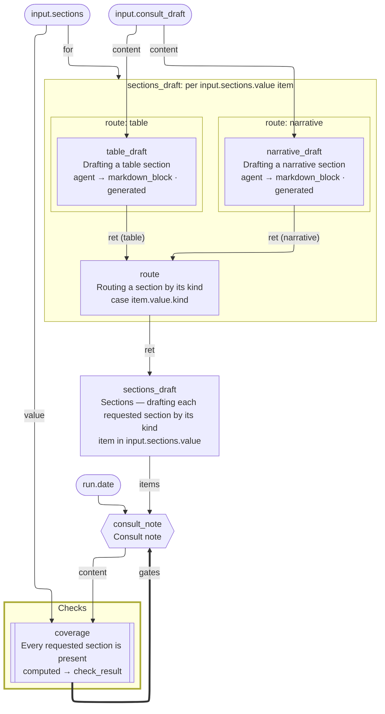
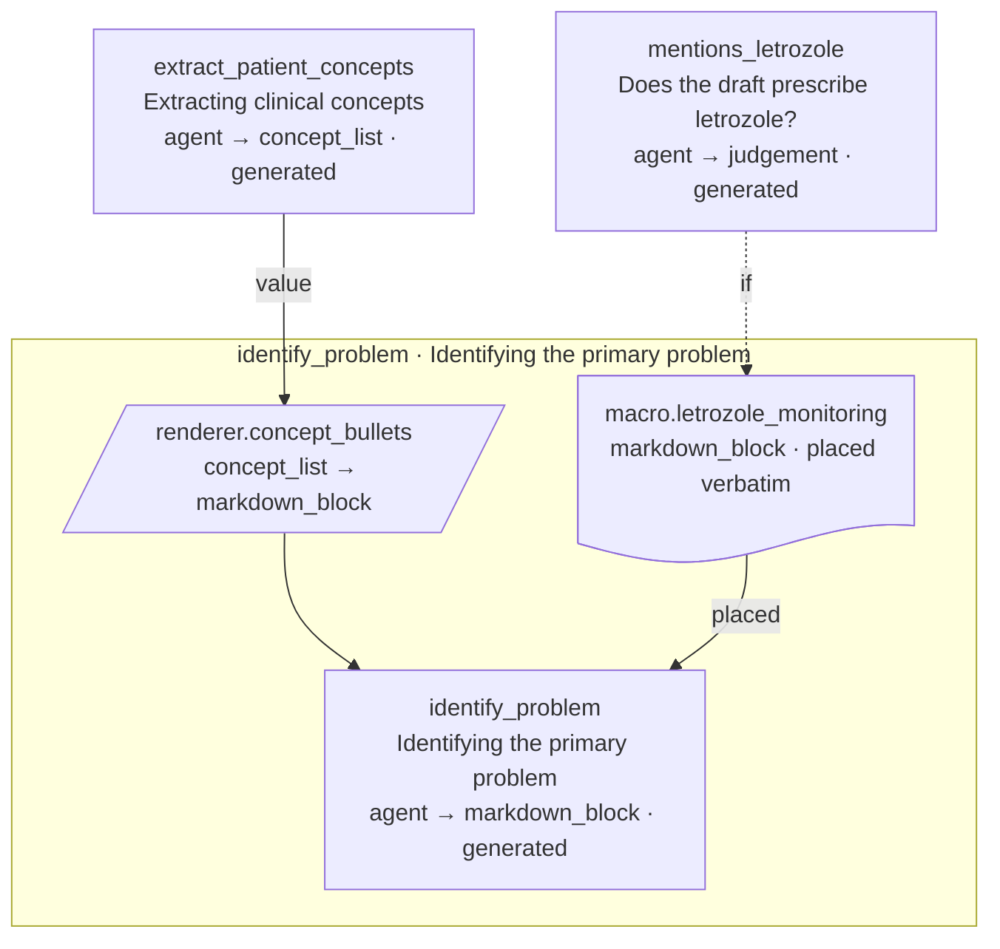
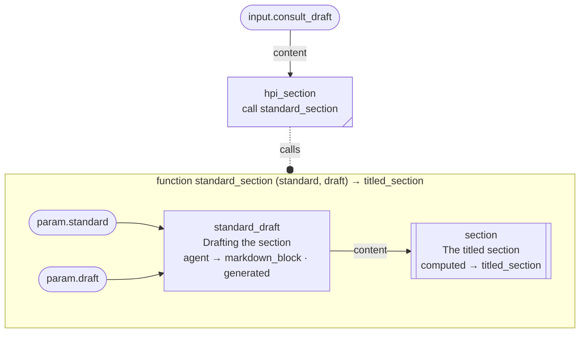

# 09. The engine and the pages

This part covers what ships beside the grammar in the same release: how the engine loads and
schedules a 31 package (#1389, #1393), the dev preview setting (#1447), the
`WorkflowPackages/Current` contract the satellites read (#1385, #1447), the Create, History and
Profile pages (#1406, #1408, #1395), the Editor, which shows 31 packages read-only until
Milestone 41 (#1447), and the diagram: `dag.mmd`, the Editor's Graph pane and the run diagram
(#1398). The grammar these rely on is in parts [01](01-files-and-scopes.md) to
[06](06-checks-deliverables-profile.md), the compiled documents in [07](07-compiled-documents.md),
and the record's shape in [08](08-record.md). The points this part left open were
[decided](https://github.com/Consultologist/Consultologist-Blazor/issues/1393#issuecomment-6980307806) on 2026-11-18, and what that decision left to the build
was [decided](https://github.com/Consultologist/Consultologist-Blazor/issues/1393#issuecomment-6984396609) the same day, with the names and shapes [decided](https://github.com/Consultologist/Consultologist-Blazor/issues/1389#issuecomment-6984743967).

## 1. Loading a package

### 1.1 Two load paths, chosen by `specVersion`

| Spec version | What the engine reads | Until |
|---|---|---|
| 5–30 | today's path: `manifest.json` and the source files, materialised and validated per load (`WorkflowPackageStore`) | retirement, #1450 (Milestone 40) |
| 31 | **only `resolve.json`** from the published version's folder in the registry | — |

- **No backfill.** Versions published before 31 never get a `resolve.json`; they keep today's path
  until they are retired. Packages that must keep running are migrated, which gives them a real
  `resolve.json` and `lock.json` ([correction](https://github.com/Consultologist/Consultologist-Blazor/issues/1389#issuecomment-6904042859)).
- **The engine never reads a 31 package's source tree** at job time. Bodies are inline in
  `resolve.json`, so one document and one hash cover everything
  ([decided](https://github.com/Consultologist/Consultologist-Blazor/issues/1389#issuecomment-6957667030)).
- **`lock.json` is not needed to run,** but it is checked at load ([decided](https://github.com/Consultologist/Consultologist-Blazor/issues/1388#issuecomment-6992455660)): its hash, and its link
  to `resolve.json` (§ 1.2, step 3). The exact versions it holds are for provenance, for the
  break points of step 4, and for the library-upgrade rule (#1390).

### 1.2 The load, step by step (31)

1. **Resolve the pin** to a `name@version`, as today (`WorkflowPackagePinResolver`).
2. **Read `resolve.json`** and **`lock.json`** from the version's folder.
3. **Check integrity** ([decided](https://github.com/Consultologist/Consultologist-Blazor/issues/1388#issuecomment-6992455660)). The SHA-256 of `resolve.json`'s bytes (canonical, RFC 8785) must
   equal the hash published for that version
   ([decided](https://github.com/Consultologist/Consultologist-Blazor/issues/1389#issuecomment-6898433175));
   `lock.json`'s hash must equal its published hash; and the link between them must hold
   (`resolve.json`'s pointer names the lock by file name, `lock.json`, and the stamp carries
   `lockHash`, part 07). A mismatch of any of
   the three refuses the load. The published hashes are in the version's stamp (part 07), and
   **a version without the "published" stamp doesn't exist** for the engine: publish writes the
   stamp last, so a publish that died partway is never loaded, and stamped folders are never
   changed.
4. **Check `requires`** against this engine: `spec`, `evaluator`, `scriban`, each operation's range,
   `kinds`, `features` and `agents`. Ranges are caret ranges set by the registry (#1390); the
   engine refuses only outside a range. An unknown kind or feature is outside every range.
   Then **compare `lock.json`'s exact versions with the engine's break points:** the engine keeps,
   per locked component, the versions at which output changed (*"Scriban output changed at
   7.3.0"*), as configuration changed only by an upgrade that went through the corpus re-render,
   and refuses a package locked before a break point with #1390's sentence (part 07 § 4.4,
   [decided](https://github.com/Consultologist/Consultologist-Blazor/issues/1389#issuecomment-6959887217), [#1390](https://github.com/Consultologist/Consultologist-Blazor/issues/1390#issuecomment-6959887636)).
5. **Build the in-memory plan:** the parsed graph, the compiled JSON Logic, the parsed Scriban
   templates and the resolved formats. **The plan is never stored;** it is derived
   deterministically from `resolve.json` and cached in memory per `name@version`, keyed also by
   the `resolveHash` ([stages](https://github.com/Consultologist/Consultologist-Blazor/issues/1389#issuecomment-6898433175)).
6. **At job start,** check `needs.profile` and the account's time zone, which every 31 job needs
   (§ 5.2). Then record `resolveHash` and `lockHash` beside the package name and
   version, before any node runs.

A refusal at steps 3 or 4 is a start failure: no node runs, and the job's record holds the
sentence. The Create page checks steps 4 and 6 before submission (§ 5.3), so in practice the
clinician sees the sentence there first.

### 1.3 Which spec versions an engine admits

- **The compiled-in list** stays `WorkflowPackageValidator.AcceptedSpecVersions` (publish) and
  `WorkflowPackageStore.SupportedSpecVersions` (load), 5–30 today. **31 joins both lists only at
  the bump** (index § 5, step 4), released after a drain.
- **Before the bump, the preview setting admits 31 on dev alone** (§ 2).
- **Production without the setting** answers a 31 publish or load with today's sentence:
  *"specVersion 31 is not supported: this engine accepts specVersion <list> (pre-v5 packages are
  archived; see registry-operations.md)."*

## 2. The dev preview setting and dev's registry

Decided on [#1447](https://github.com/Consultologist/Consultologist-Blazor/issues/1447#issuecomment-6957669427):
31 is proven on `canada-east-ai-function-dev` first, with dev's own package registry, and
production's registry never sees a 31 package until the bump.

### 2.1 `WorkflowPackages__PreviewSpecVersions`

| | |
|---|---|
| **Type** | a comma-separated list of integers, for example `31` |
| **Unset or empty** | no preview versions: only the compiled-in list is admitted. This is production's value, always |
| **Effect** | each listed version is admitted **beside** the compiled-in list, everywhere a version is checked: publish, import, load, job start, `WorkflowPackages/Current` |
| **Allowed values** | only versions this build implements but has not yet released. In Milestone 39 that is `31` alone |
| **Set on** | `canada-east-ai-function-dev` only |
| **Removed** | at the bump, when 31 joins the compiled-in list |

- **A listed version this build doesn't implement** stops the host at startup, naming the
  setting and the value ([decided](https://github.com/Consultologist/Consultologist-Blazor/issues/1393#issuecomment-6980307806)): a typo must not silently admit nothing, and an
  unimplemented version must never be admitted.
- **The engine attestation** (`EngineAttestation`) lists preview versions separately, as
  `PreviewSpecVersions`, beside `AcceptedSpecVersions` and `SupportedSpecVersions`, so an
  attestation never presents a preview version as released ([decided](https://github.com/Consultologist/Consultologist-Blazor/issues/1393#issuecomment-6980307806)).

### 2.2 Dev's own registry

- **Dev's registry lives in `consultdevcaeast`.** Today dev isolates its storage there but reads the
  shared public registry (`consultpubcaeast`); for Milestone 39, dev's `WorkflowPackages__*`
  settings (the private and public blob service URIs) point at containers in `consultdevcaeast`.
- **What dev's registry holds:** the format spec, agents catalogue and provenance releases (index
  § 5, step 1), the example packages at 31, and copies of account packages for the dry run, all
  with fictional content only. The catalogues are copied into dev's registry from
  the same release tags production uses ([decided](https://github.com/Consultologist/Consultologist-Blazor/issues/1393#issuecomment-6984396609)), and the example packages are published to it through
  `WorkflowPackages/Publish` from the migration branch, not by the public repository's tag CI
  (which publishes to production).
- **Smoke runs and the migration's dry run** happen on dev with fictional inputs. Dev's
  `Diagnostics__LogPromptText=true` stays a dev-only switch, as today.

## 3. Scheduling

### 3.1 What runs when

The orchestrator runs the plan's graph as today: a node is ready when everything it reads has
settled, loops fan out per item, `while` runs pass by pass, branches decide before their bodies.
What changes at 31:

- **The order comes from `resolve.json`** (`graph.order` and the edges), not from walking the
  manifest.
- **`computed` nodes, conditions and checks** run in the orchestrator through the JSON Logic
  evaluator (part 03), with no model call, and (but for a rule that holds a pattern, below) no
  activity. They are evaluated inline
  in the orchestrator ([decided](https://github.com/Consultologist/Consultologist-Blazor/issues/1393#issuecomment-6984396609)), as a deterministic function of recorded values, so replay reproduces them;
  `rendered` nodes and deliverables render in an activity, as templates do today.
- **A `call`'s function body runs inline** in the job's orchestration ([decided](https://github.com/Consultologist/Consultologist-Blazor/issues/1388#issuecomment-6992455660)), never as a
  Durable sub-orchestration: its nodes are scheduled by the same loop as every other node, so the
  per-job ceiling, the total-work limits and the dispatch order of § 3.2 hold inside functions.
  Its rows are keyed under the call (part 08). **The dev dry run measures the orchestration
  history's size and replay time** for the largest example package ([decided](https://github.com/Consultologist/Consultologist-Blazor/issues/1388#issuecomment-6993822677); part 10 § 1.7); if the
  history passes 10 MB or a step's replay takes over 2 seconds, if it's exceeded, the bump waits and #1493 (sub-orchestrations with a shared ceiling, Milestone 40) is pulled forward.
- **A pattern's decision is stored** ([ruled by the owner](https://github.com/Consultologist/Consultologist-Blazor/issues/1505#issuecomment-7064144103), ruling 3): each evaluation of `matches` and
  `has_word` has the engine's time limit (#1503; part 03 § 5.3's bounds still apply), so its result
  can differ between a run and its replay. A rule that holds either, at any depth, is evaluated in
  an activity (`evaluate-rule-v31`), and its outcome is stored in the orchestration's history: a
  replay reads the decision and never times the pattern again. Every other rule is evaluated
  inline. Every time the orchestrator records (a decision's `decidedAtUtc`) comes from the
  orchestration's replay-safe clock.
- **Check loops** are scheduled per item, as soon as their production item settles (#1396), not
  after the whole production loop.

### 3.2 The per-job ceiling

Decided on [#1393](https://github.com/Consultologist/Consultologist-Blazor/issues/1393#issuecomment-6904683179),
option D.

- **An engine setting, not part of the format.** At most *N* agent calls are in flight for one
  job at any moment. The default is **16**.
- **Setting name: `ConsultGeneration__MaxAgentCallsPerJob`**, an integer from 1 upward; unset means
  16 ([decided](https://github.com/Consultologist/Consultologist-Blazor/issues/1393#issuecomment-6984396609)).
- **What counts:** only agent calls ([decided](https://github.com/Consultologist/Consultologist-Blazor/issues/1392#issuecomment-6963556118)): every node of kind `agent`,
  including a classifier that decides a macro's `if`. Calls inside nested loops, inside function calls
  ([#1419](https://github.com/Consultologist/Consultologist-Blazor/issues/1393#issuecomment-6897233461))
  and inside check loops all count the same way. A repair retry (`onInvalid: retry`) and a 429
  retry occupy the same slot as the call they repeat. `computed`, `rendered`, conditions and
  deliverables take no slot: they call no model.
- **With `maxParallel`:** each loop's `maxParallel` still limits its own items, **per loop
  instance**, so nested caps multiply. The effective limit on any one call is the smaller of the
  caps along its nesting path and the per-job ceiling. `maxParallel` is 2–15, or `null` for no cap
  of its own (`FormatBounds.parallel`, part 01), in which case only the ceiling applies.
- **Which call waits when the ceiling is reached** ([decided](https://github.com/Consultologist/Consultologist-Blazor/issues/1393#issuecomment-6984396609)). Ready calls are dispatched in a
  fixed order: by the node's position in `graph.order`, then by item path (outer items first,
  then list order), then by pass. A freed slot goes to the first waiting call in that order. This
  keeps dispatch deterministic, so Durable replay and the record agree. The order of completion
  still depends on the model.
- **Implementation:** a counter of in-flight agent calls kept in the orchestrator's state, checked
  before each dispatch. Durable fan-out today dispatches every ready activity at once
  (`ConsultGenerationEngine`'s pending-task loop); at 31 it dispatches only up to the free slots
  and waits on `Task.WhenAny` for the next free one.
- **The record** holds the ceiling in force at job start, once, in the job header's `limits`
  beside the other limits of § 3.4 (part 08, [decided](https://github.com/Consultologist/Consultologist-Blazor/issues/1389#issuecomment-6984743967)); the peak concurrency actually reached is
  kept in telemetry only ([decided](https://github.com/Consultologist/Consultologist-Blazor/issues/1393#issuecomment-6980307806)).
- **Applies to 31 only** ([decided](https://github.com/Consultologist/Consultologist-Blazor/issues/1393#issuecomment-6984396609)). Packages at 5–30 keep today's scheduling, so the old path is
  unchanged until it retires.

### 3.3 Deployment-wide limits

There is **no shared counter** across jobs. Deployment-wide limits come from host configuration,
sized to the model deployment's quota
([decided](https://github.com/Consultologist/Consultologist-Blazor/issues/1393#issuecomment-6904683179)):

- `host.json` gains `extensions.durableTask.maxConcurrentActivityFunctions` (today unset, so the
  default applies per instance);
- the Flex Consumption app's maximum instance count is set so that instances × activities stays
  within the quota.

The values are deployment configuration, recorded in `docs/` beside the deployment notes, not in
this design. **Option C** (a per-deployment Durable entity counting calls across jobs) is kept for
later, if fairness across accounts needs exact control.

### 3.4 Retries and limits

[Decided](https://github.com/Consultologist/Consultologist-Blazor/issues/1393#issuecomment-6984396609) on 2026-11-18. This changes #1393's first decision that a job is never failed for capacity
alone: a throttled job is slower, but it isn't kept waiting without end.

- **A 429 from the model deployment is retried** after the response's `retry-after` (or
  `retry-after-ms`) when present; otherwise with back-off from 5 seconds, doubling, capped at
  60 seconds, with jitter. **The node fails after 10 minutes** of waiting on 429s in total.
- **Other service failures** (a 5xx response, a timeout, no connection) are retried with the same
  back-off, **5 attempts** in all; then the node fails. The record keeps the last error's kind,
  never its content. This replaces the activity's three attempts today
  (`AgentActivityRetryOptions`) for agent calls at 31.
- **A job fails if it hasn't finished 30 minutes after its orchestration started**
  (`startedAtUtc`), not after its creation or scheduling, so time spent queued or waiting behind a
  drain doesn't count ([decided](https://github.com/Consultologist/Consultologist-Blazor/issues/1388#issuecomment-6992455660)). Real jobs took about 2 minutes at the median and 12 at the longest
  (22 jobs over 30 days). **Activities still running at the limit** are recorded with the row
  state `cancelled`, and their late results are ignored.
- **Total-work limits** ([decided](https://github.com/Consultologist/Consultologist-Blazor/issues/1388#issuecomment-6992455660)), starting at: **200 items per loop instance**, **500 agent calls
  per job** (a retry is part of its call), **10,000 instances per job**, and **100,000 steps per render**.
  The instances limit is the tenth limit ([ruled by the owner](https://github.com/Consultologist/Consultologist-Blazor/issues/1506#issuecomment-7064144456), ruling 1), since nested loops can
  otherwise open 200³ frames before any agent call counts. **An instance is anything the runner opens
  with a row key:** a node, check or deliverable instance, a loop item, a pass, a call. The limit is
  checked where the runner opens one; past it the job fails with A09-001 and the instance is not
  opened (decided in the build, #1506). 10,000 is twenty times the agent-call limit, a starting value
  the owner may change. The publish half is #1508.
  Each limit is checked at run time and fails the node or the job with a sentence (§ 9), and is noted at publish when the
  package's worst case can exceed it (§ 3.5).
- **Delivering has its own window** ([decided](https://github.com/Consultologist/Consultologist-Blazor/issues/1388#issuecomment-6994467727)): **`deliveryMinutes` (15)**, outside the
  30-minute production limit. Production's 30 minutes ends when the last node finishes; the job
  then enters `delivering` (§ 3.8), so slow deliveries never fail the job for time.
- **All of these are engine settings,** not part of the format, recorded in the job header's
  `limits` at job start (part 08): `capacityWaitMinutes` (10), `serviceAttempts` (5),
  `jobMinutes` (30), `deliveryMinutes` (15), `deliveryAttempts` (3), `loopItems` (200), `jobAgentCalls` (500), `jobInstances` (10,000) and
  `renderSteps` (100,000), beside `maxAgentCalls` (§ 3.2). The instances limit's setting is
  `ConsultGeneration__JobInstances`.
- **Every retry is recorded on the node's row** (part 08): its time, the wait applied, whether it
  was for capacity or a service failure, and the error's kind. No model text is involved.
- **A failed node fails its job;** nothing is half-delivered. The sentences are in § 9.

### 3.5 The publish note

At publish, when a package's nested caps multiply past the engine's per-job ceiling, the publish
report carries a **note**, never a refusal. The worst case is computed from `resolve.json`: the
product of `maxParallel` along each nesting path, summed over branches that can run at the same
time. **A `maxParallel: null` loop counts its list's length when publish knows it** (a snippet
folder), **and otherwise counts as unbounded,** which the note says
([decided](https://github.com/Consultologist/Consultologist-Blazor/issues/1392#issuecomment-6963556118)). Requiring a non-null `maxParallel` is #1474 (Milestone 40).

> *"Up to <n> agent calls could run at once; this engine runs at most <ceiling> per job, so the
> rest wait their turn."*

For an unbounded worst case:

> *"An unbounded number of agent calls could run at once, since <loop key> has no maxParallel and
> reads a list of unknown length; this engine runs at most <ceiling> per job, so the rest wait
> their turn."*

The ceiling quoted is the publishing engine's setting. A package valid on one deployment is
valid on every deployment; only the note's numbers differ.

**The total-work limits and the job limit are noted the same way** ([decided](https://github.com/Consultologist/Consultologist-Blazor/issues/1388#issuecomment-6992455660)): when a loop's list
could be longer than the items limit, when the package's worst case could make more agent calls
than the job allows, and when its estimated worst case passes the job limit (S09-016: one minute
for every round of the ceiling's agent calls in the worst case, rounded up). Each is a note, never
a refusal (part 04 § 10.2).

**The instances limit refuses** (ruled by the owner on [#1508](https://github.com/Consultologist/Consultologist-Blazor/issues/1508), the publish half of § 3.4's tenth limit):
publish counts the instances the package's worst case could open, as the runner counts them (a
node, check or deliverable instance, a loop item, a pass, a call's body), each body as often as it
can run: a loop's items the least of its known length, the items limit and its `max`; a while's
`max` passes, and one more when it checks first; the larger branch of an `if` or a `case`; a call
its function's body. A loop over a list known only at run time is bounded by the items limit, so
no path is unbounded for this count. Past the engine's `jobInstances` (10,000) publish refuses:

> *"Up to <n> steps could run in one job, through <loop key>; this engine runs at most <limit> for
> one job. Lower a loop's max or split the workflow."*

### 3.6 Every deploy is preceded by a drain

**No job spans two builds** ([decided](https://github.com/Consultologist/Consultologist-Blazor/issues/1388#issuecomment-6992455660); built under #1491). The drain is defined as follows ([decided](https://github.com/Consultologist/Consultologist-Blazor/issues/1388#issuecomment-6994467727)):

- **The release workflow calls `POST Admin/Drain` before deploying and `POST Admin/Resume` after.**
- **New jobs are accepted and queued.** The HTTP starter answers `202` with a job id and holds the
  job, shown as *"Waiting for an update to finish"*; it starts after resume. **Scheduled and email
  jobs wait the same way.**
- **Running jobs finish.** The deploy proceeds once no orchestration is producing or delivering,
  so a job in `delivering` (§ 3.8) is waited for too.
- **The hard cap is 60 minutes:** a job can legitimately take 45 (the 30-minute production limit,
  then the 15-minute delivery window), and the rest is margin
  ([decided](https://github.com/Consultologist/Consultologist-Blazor/issues/1388#issuecomment-6994467727); cap set to 60 by the package author). After it the deploy fails and stays undeployed; the operator investigates.

So rows don't record a build: the job header's `engineCommit` and `engineRelease` hold for every
row, and `versionsRan` takes exactly `lock.json`'s shape (part 08 § 3). Time a job spends waiting
behind a drain doesn't count towards its job limit (§ 3.4).

### 3.7 Where the record is written

The record moves out of the Durable entity ([decided](https://github.com/Consultologist/Consultologist-Blazor/issues/1388#issuecomment-6992455660); part 08 § 1.1):

- **Each record row is written once, to a table, when it finishes,** keyed by the job id and the
  escaped rooted key, and never rewritten. **The write is insert-if-absent** ([decided](https://github.com/Consultologist/Consultologist-Blazor/issues/1388#issuecomment-6993822677)): an identical
  second write (a Durable replay) is a no-op; a differing one is refused and recorded as an
  engine fault.
- **The entity keeps only the job header and progress.** Events carry keys, not row contents;
  the browser fetches a finished row by its key.
- **A job that finishes producing and has deliveries to make is `delivering`** (§ 3.8); its
  delivery attempts are rows too (part 08 § 10).
- **The record is sealed when delivery ends.** On every terminal state (completed, failed, cancelled or timed out; [decided](https://github.com/Consultologist/Consultologist-Blazor/issues/1388#issuecomment-6993822677)) the engine assembles
  the canonical record document from the rows into a blob in the records account's `job-records` container, noting the end state, and writes its hash, `recordHash`, on the header. History's download and the export serve that blob.

### 3.8 Delivery at the end

Built under #1492. **Nothing is delivered until every deliverable's outcome is final and the job has succeeded**
([decided](https://github.com/Consultologist/Consultologist-Blazor/issues/1388#issuecomment-6992455660); part 06 § 8). The job then enters **`delivering`**, shown as *"Delivering…"*
([decided](https://github.com/Consultologist/Consultologist-Blazor/issues/1388#issuecomment-6994467727)), with the document viewable throughout. Delivery runs once per destination of each
released deliverable, and each attempt is written to **a delivery row in the one record**,
`delivery:<deliverable>/<destination>` (part 08 § 10). **The record, its blob and `recordHash`, is
sealed when delivery ends,** not before. A job that fails delivers nothing and goes straight to its
terminal state.

**Delivering has its own 15-minute window** (`deliveryMinutes`, § 3.4), outside the 30-minute
production limit; a destination still unsent when it closes is `failed`.

**A failed delivery is retried** ([decided](https://github.com/Consultologist/Consultologist-Blazor/issues/1388#issuecomment-6993822677)): **3 times** (`deliveryAttempts`), **with back-off inside the 15-minute window** (engine
settings, § 3.4), each attempt recorded on the destination's result. After the last, the result is marked
`failed`, the operator is alerted (§ 3.9), and History shows *"Couldn't send to <destination>.
Copy the note instead."* The job stays completed.

### 3.9 Monitoring and alerts

Built under #1492. Minimal, on Application Insights, **lengths and hashes only, never text** ([decided](https://github.com/Consultologist/Consultologist-Blazor/issues/1388#issuecomment-6993822677)). Alerts are
emailed to the operator:

- **Any failed job.**
- **429 waiting** passing 5 minutes in one job (§ 3.4).
- **A job reaching 80% of the 30-minute limit** (24 minutes).
- **A failed publish or an exporter warning** (part 10).
- **A delivery marked `failed`** (§ 3.8).

**A weekly summary** is emailed too: jobs, failures, p50 and p90 duration, the largest record, and
outstanding migration hand edits.

## 4. The satellites' contract: `WorkflowPackages/Current`

### 4.1 The rule

`GET WorkflowPackages/Current` is the **only** contract the Copilot agent
(`consultologist-copilot-agent`) and the Zoom app (`consultologist-zoom-app`) read, and it
**changes by addition only**
([decided](https://github.com/Consultologist/Consultologist-Blazor/issues/1385#issuecomment-6957666238),
[#1447](https://github.com/Consultologist/Consultologist-Blazor/issues/1447#issuecomment-6957669427)).
A satellite built for 30 keeps working against a 31 package: every member it reads today means
what it meant. The satellites are updated before the cutover to read the new member, so they
work with both 30 and 31.

The Copilot agent mirrors `WorkflowPackageResponse(Name, Version, SpecVersion, Inputs, Macros,
Title)` and the input, field and element records
(`src/Consultologist.CopilotAgent.Core/Engine/EngineDtos.cs`), and builds Teams intake cards from
`Id`, `Label`, `Required`, `Type`, `Values`, `Items` and `Fields`.

### 4.2 The response at 31

| Member | At 5–30 | At 31 |
|---|---|---|
| `Name`, `Version`, `SpecVersion`, `Title` | as today | as today; `SpecVersion` is `31` |
| `Blocks` | the top-level blocks | one per **top-level** node of `resolve.json`, in the graph's order: `Id` its key with root (`node.plan`), `Name` its `label`. Nodes inside loops and `while`s aren't listed; the rail shows their items and passes under their parent |
| `Inputs` | as today | each input mapped into today's fields (§ 4.3), **plus `Format` and `Channel`** |
| `Results` | the deliverables | one per deliverable: `Id` its key (`deliverable.emr.note`), `Label` from its header |
| `Macros` | the optional macros, or `null` when none | **always `[]`**: 31 has no per-run macro choices; they migrated to optional boolean inputs (#1412, #1447) |

`Blocks` and `Results` are [decided](https://github.com/Consultologist/Consultologist-Blazor/issues/1393#issuecomment-6980307806): the rail, the record and History all match rows by the
same key. `Format`, `Macros: []` and unset optional booleans sent as `null` were decided in
[part 02](https://github.com/Consultologist/Consultologist-Blazor/issues/1385#issuecomment-6962669466).

### 4.3 Inputs at 31

The input record gains two trailing members; every existing member is filled:

```csharp
public sealed record WorkflowPackageInputResponse(
    string Id, string Label, bool Required,
    string? Type = null, IReadOnlyList<string>? Values = null,
    WorkflowPackageElementResponse? Items = null,
    IReadOnlyList<WorkflowPackageFieldResponse>? Fields = null,
    string? ExpectedContent = null, IReadOnlyList<string>? Types = null,
    JsonElement? Format = null,    // new: null below 31
    string? Channel = null);       // new: null below 31
```

| Existing member | Filled at 31 from |
|---|---|
| `Id` | the input's key in `manifest.json`'s `inputs` object |
| `Label` | its `label` |
| `Required` | its `required` |
| `Type` | its format, mapped ([decided](https://github.com/Consultologist/Consultologist-Blazor/issues/1385#issuecomment-6962669466)): a text format (`plaintext`, `markdown_block`) → `text`; `string` with `enum` or a labelled `oneOf` → `enum`; a plain `string` → `text`; `date` → `date`; `boolean` → `boolean`; `number` and `integer` → `number`; an object → `object`; an array → `array` |
| `Values` | for an enum, the `enum` values, or the `const` of each `oneOf` entry, in order (titles are in `Format`) |
| `Items` | for an array, its `items` mapped the same way, at every depth |
| `Fields` | for an object, one per entry in `properties`, in written order (the object's `propertyOrder` in `resolve.json`, part 07 § 2.2, [ruled](https://github.com/Consultologist/Consultologist-Blazor/issues/1508#issuecomment-7179739459), since canonical JSON sorts the properties): `Id` the property name, `Label` its `title` (the property name when there is none), `Required` as part 02 defines a required field, the rest mapped the same way |
| `ExpectedContent` | its `channel` (part 02) |
| `Types` | `null` (31 has no union inputs) |
| **`Format`** (new) | the input's format as a self-contained schema: a JSON Schema in the dialect, with its `$id`s kept and its `$ref`s resolved within the document ([decided](https://github.com/Consultologist/Consultologist-Blazor/issues/1385#issuecomment-6962669466)). It carries no `propertyOrder` (part 07 § 2.2): that member is left out at every depth, so `Format` stays a schema in the dialect, and `Fields` carry the written order. `null` for every package below 31 |
| **`Channel`** (new) | its `channel` ([decided](https://github.com/Consultologist/Consultologist-Blazor/issues/1393#issuecomment-6984396609)). `null` when it has none, and for every package below 31 |

- **Inputs come in written order,** which is the Create page's order (#1385), from `resolve.json`'s
  explicit order (part 07).
- **`Channel`** (new) carries the input's `channel` (`transcript`, `image`, `ambient-note`,
  `form`, or `null`), added alongside the existing fields, so a satellite can tell an input it
  can't fill, such as a document-only one, and show *"This workflow needs the web app"* (§ 4.4,
  [decided](https://github.com/Consultologist/Consultologist-Blazor/issues/1393#issuecomment-6984396609)). `ExpectedContent` is filled from the same `channel`, so a satellite built for 30
  reads what it read before.
- **No `description` member yet** ([decided](https://github.com/Consultologist/Consultologist-Blazor/issues/1385#issuecomment-6962669466)).
  A satellite that wants it reads `Format`'s annotations or waits for a later addition.

### 4.4 What a satellite can't show

A satellite that meets an input it can't render (for example an inline object schema it doesn't
support, or an input whose only practical filling is a document upload) doesn't start a job. It
shows, with a link to the Create page for that package:

> *"This workflow needs the web app"*

The satellites' own work (reading `Format`, the fallback, releases) is filed as issues in their
repositories and linked from the build parent issue (#1447). The SMART panel and the email intake
are checked against the same contract.

## 5. The Create page

### 5.1 Inputs

The Create page draws a 31 package's inputs from their formats
([widgets](https://github.com/Consultologist/Consultologist-Blazor/issues/1398#issuecomment-6878756627),
[grammar](https://github.com/Consultologist/Consultologist-Blazor/issues/1385#issuecomment-6919612460)),
in written order, each with its `label` and its `description` as help text:

| Format | Widget |
|---|---|
| `string` | a single-line field |
| `string` with `enum` | a select showing each value as written |
| `string` with a labelled `oneOf` | a select showing each entry's `title`, sending its `const` |
| `plaintext` | a text area |
| `markdown_block` | a rich-text editor, stored as Markdown |
| `date` | a date picker |
| `boolean` | three states, **unset, yes and no**, starting unset; unset is sent as `null` (not given), which `=== true` reads as false and `!== false` reads as true, matching how per-run macro choices migrate (#1412) ([decided](https://github.com/Consultologist/Consultologist-Blazor/issues/1385#issuecomment-6962669466)) |
| `number`, `integer` | a number field |
| an object | a field group, one field per property, by the same table, to any depth |
| an array | repeating rows of its `items` |

- **Inputs refuse `markdown_inline`** (part 02), so it has no widget.
- **Required and blank** ([decided](https://github.com/Consultologist/Consultologist-Blazor/issues/1385#issuecomment-6959885810)): an input with `"required": true` must be supplied; one with
  `"required": false` left blank is sent as `null`. Inside an object input, every field is in the
  format's `required` list: a field with a nullable type is optional, and left blank is sent as
  `null`; a field whose type is not nullable must be filled in before Start is enabled.
- **Documents need no member.** Any text-format input takes typed text or a document; an array of
  text takes typed rows, documents and earlier runs' deliverables in the order sent (#872, #874,
  #1144), as today. A document sent to a Markdown input gives its extracted text, as at 30 (the
  converter to Markdown is Milestone 40, #1442), and the parser's and OCR's versions are recorded
  with the input
  ([decided](https://github.com/Consultologist/Consultologist-Blazor/issues/1389#issuecomment-6924904289)).
- **`channel`** (`transcript`, `image`, `ambient-note`, `form`) does what `expectedContent` does
  today; only the name changes.
- **No macro panel** for a 31 package: its per-run choices are ordinary boolean inputs.
- **Personal snippets** are inserted into inputs as today; they are never `profile.*` reads.
- **An input the page has no widget for** (a format with a part none of the table's rows draws) is named, and Start stays
  disabled, with A12-006: *"This workflow can't be filled in here: this page has no field for '<input label>'. Tell the
  operator."* (decided in the build, #1509).

### 5.2 The signature choice

- **Shown only when the account has more than one signature block**
  ([decided](https://github.com/Consultologist/Consultologist-Blazor/issues/1408#issuecomment-6957668236)),
  **and** the package reads `profile.signature` (it is in `needs.profile`)
  ([decided](https://github.com/Consultologist/Consultologist-Blazor/issues/1393#issuecomment-6980307806)).
- **Defaults to the account's chosen block** (`ChosenId`). The pick applies to this job only and
  never changes `ChosenId`.
- **The record names the block's id,** never its text (#1408), and whether it was the default or
  this job's pick (`signatureChosen`, part 08).

### 5.3 Checks before submission

Before the clinician can start a job, the page checks what `resolve.json` declares, and shows
each failing sentence above the Start button, which stays disabled until all pass:

1. **`requires`** against the engine, and `lock.json` against its break points: #1390's
   sentence (§ 9).
2. **`needs.profile`:** each field the package reads must be set on the account. The signature's
   sentence is decided; the others follow the same form (§ 9).
3. **The time zone:** every job needs the account's time zone set ([decided](https://github.com/Consultologist/Consultologist-Blazor/issues/1406#issuecomment-6958802620)).

The engine repeats the same checks at job start (§ 1.2, step 6), so a job sent another way (a
satellite, the email intake) is refused with the same sentences.

The page asks the engine for the account's sentences (`GET WorkflowPackages/Current/StartChecks`, which reads the account with
the code a start reads it with) after a 31 package loads, on each pick, on window focus and before a start
(decided in the build, #1509). When they cannot be asked, Start stays disabled with A12-004: *"The workflow's checks couldn't be
run. Reload the page to try again."*

## 6. History

### 6.1 Which records

History reads **record storage 12** for jobs on 31 packages, and keeps reading **storage 2–11**
exactly as today ([decided](https://github.com/Consultologist/Consultologist-Blazor/issues/1388#issuecomment-6957680891)).
The record's members are part 08's; this section is only how they are shown.

### 6.2 The job header

As today, plus:
- **`resolveHash` and `lockHash`**, beside the package name and version
  ([decided](https://github.com/Consultologist/Consultologist-Blazor/issues/1389#issuecomment-6898433175));
- **for a migrated version,** the publish record's line *"migrated by the operator from <old
  version>"*, linking to the byte-equivalence report and the list of hand edits (#1447);
- **the limits** in force at job start: the per-job ceiling and the retry and time limits
  ([decided](https://github.com/Consultologist/Consultologist-Blazor/issues/1393#issuecomment-6980307806), §§ 3.2 and 3.4).
- **a job that stopped** (not terminal, started more than 60 minutes ago: § 3.6's hard cap) is shown *"Stopped"* with A12-001: *"This job stopped before it
  finished, so it has no record. Run the workflow again."* (decided in the build, #1509, D9).

### 6.3 Banners

A deliverable that wasn't sent is never something to dig for. At the top of the job, one banner
per deliverable that was held, failed or blocked, and per destination not sent or failed
([decided](https://github.com/Consultologist/Consultologist-Blazor/issues/1395#issuecomment-6881869311), revised by [decided](https://github.com/Consultologist/Consultologist-Blazor/issues/1388#issuecomment-6992455660)):

> *"<deliverable label> was blocked: check '<check id>' failed (<check detail>)."*

A gate check that errored gives *"<deliverable label> was blocked: check '<check id>' could not
run (<error>)."* The same banner covers a destination the account hasn't set up (*"not sent: EMR isn't set up for
this account"*, #1408) and a deliverable held by `whenEmpty: hold` (*held: empty*, #1406).

### 6.4 The sections, in the order the job runs

```
 History: job 0256b714…
 ├ Inputs
 ├ Run facts
 ├ Nodes            (production: what was made)
 ├ Checks           (verification: what was tested)
 └ Deliverables     (outputs: what was released, held or blocked, and where it was sent)
```

Inputs, Nodes, Checks and Deliverables are #1395's order. **Run facts** is #1389's new section;
its place directly after Inputs is [decided](https://github.com/Consultologist/Consultologist-Blazor/issues/1393#issuecomment-6984396609) (run facts, like inputs, come from outside the package and
are fixed before any node runs).

**Inputs.** Each input with its origin (typed, document, earlier run), its hash and, for a
document, the extraction versions (converter, parser, OCR service and model).

**Run facts** ([decided](https://github.com/Consultologist/Consultologist-Blazor/issues/1389#issuecomment-6920512005)).
Each fact the package read and its raw value (`run.date: 2026-11-16`, with the zone
`America/Toronto`), and every run spot that read it: the body, the site and the formatted output
(*"16 November 2026"*). Run facts are kept permanently; a spot's output is kept permanently only
when the spot reads raw `run.*` facts, and otherwise shows its hash after the 7-day drop ([decided](https://github.com/Consultologist/Consultologist-Blazor/issues/1388#issuecomment-6992455660)). Beside any body whose run-neutral hash and
sent-text hash differ, History says so, with A12-003: *"Part of this text comes from run facts, such as the date, so it differs from
run to run."* (decided in the build, #1509: for a prompt the sent text is its `inputHash`, for a rendered node its `outputHash`,
for a deliverable its `composedHash`, for a macro its `contentHash`; a computed row is no body).

**Nodes.** One row per node, by its key with root (`node.sections.paragraphs.draft_paragraph`,
#1384, [roots](https://github.com/Consultologist/Consultologist-Blazor/issues/1383#issuecomment-6961890910)):
- **loops** expand per item, each named by the loop's `itemLabel` (after the 7-day drop, by
  position, *Sections 3*, unless the label comes from package text, [decided](https://github.com/Consultologist/Consultologist-Blazor/issues/1388#issuecomment-6992455660)); `while` expands per pass; an
  item that didn't run shows its state and reason;
- **a condition decision** shows the printed condition and its result, with the reason sentence
  for a skip: *"skipped: input.kind.value = "table" is false"*; a run-dependent decision is marked so,
  and the mark stays on the decision: what it chose isn't marked for it ([decided](https://github.com/Consultologist/Consultologist-Blazor/issues/1388#issuecomment-6992455660));
- **renderer sub-rows** under the node that used them, keyed by the use's position
  (`node.identify_problem/render:1`), one per step of a chain: the renderer's id, the input hash
  and the output hash (#1397);
- **macro rows** under the node that offers them: offered or not (linking to the `if` decision),
  placed or not (the marker found exactly once), the content hash; the `onInvalid` outcome is on
  the node's own row (#1412);
- **agent rows** name the attested agent definition (id and version) and the binding that chose
  it (#1385); when keywords were removed from the format sent to the model, the row says
  *"Not sent to the model: …"* ([decided](https://github.com/Consultologist/Consultologist-Blazor/issues/1385#issuecomment-6962669466));
- **model-derived values** are marked on their rows: *"computed from model text: node.draft"*
  ([decided](https://github.com/Consultologist/Consultologist-Blazor/issues/1386#issuecomment-6962982698));
- **retries** on the node's row: how many, for capacity or for a service failure, and the total
  wait (§ 3.4);
- **a `call`** is one row that expands to its own rows, keyed under the call
  (`node.hpi_section.standard_draft`, #1419); the run diagram's call box links here.

**Checks** ([decided](https://github.com/Consultologist/Consultologist-Blazor/issues/1395#issuecomment-6881869311)).
Each check row has four lines:

| Line | Shows |
|---|---|
| checks | what it ran on (a deliverable or a node), with that output's hash |
| reads | its other inputs, each linking to its row |
| result | the `check_result`: pass or fail, with its `message`; `uncovered` and `untested` until the 7-day drop, then their hashes and sizes (#368, [decided](https://github.com/Consultologist/Consultologist-Blazor/issues/1395#issuecomment-6978700251)) |
| effect | what happened because of it: released, held, blocked, or read by something else |

A check loop expands per item, beside the production item it is aligned with and named by the
same `itemLabel`; an aggregate (`all_pass`, `count_pass`) shows its result and its `failWith`
sentence (#1396).

**Deliverables** ([layout](https://github.com/Consultologist/Consultologist-Blazor/issues/1406#issuecomment-6881577331)).
Each deliverable row shows its state (released, held, failed, skipped, blocked), its format and its
composed hash; its template, shown from the pinned version (from `resolve.json` at 31); its reads
grouped by template line, expandable per pass, each with size and hash; one line for its check
(`Check: coverage  passed →`, linking to the check's row); and, per destination, sent or not
sent with the sentence. A deliverable whose gating check was skipped by its own `if` shows
*"released: check '<id>' didn't apply (its if was false)"*; a bundle lists what it left out and why
([decided](https://github.com/Consultologist/Consultologist-Blazor/issues/1395#issuecomment-6978700251)). Profile reads show the field and its hash, never its text after the
7-day drop; the signature read names the block's id. **A blocked deliverable's text** is shown under the heading
*"Refused, not delivered"*, with the check that refused it and its sentence, so nobody copies it out by mistake: the
panel has no copy control and cannot be selected, and the text is in no copy or download the page offers. It is shown
while it is retained (7 days); after that the heading and the hash remain, with A12-002 (ruled by the owner on #1507,
item 3). There is no release button at 31: releasing after review is #1524, Milestone 40. The template is shown only when
`CanonicalJson.HashText` of its body in `resolve.json` equals the row's `templateHash`; otherwise the row says A12-007: *"The
template this job ran couldn't be read, so it isn't shown."* (decided in the build, #1509).

**Verify** (beside the record's download, for a terminal job) re-checks the downloaded record and each deliverable's retained text
against their hashes in the browser (`RecordCheck31`). When the record or a row it needs cannot be fetched it says A12-005: *"The record couldn't be checked:
<what could not be read>."* (decided in the build, #1509).

### 6.5 Test results

**In-package test results are never in a job's record** (#1449). They are in the publish report,
which the Editor shows for the version (§ 8).

## 7. Profile

Decided on [#1408](https://github.com/Consultologist/Consultologist-Blazor/issues/1408#issuecomment-6957668236).

### 7.1 The "Letter details" card

A new card on the Profile page for the profile fields that have no home today:

| Field | Format | Control | Empty means |
|---|---|---|---|
| `profile.credentials` | `string` | single-line field | not set |
| `profile.organisation` | `string` | single-line field | not set |
| `profile.closing` | `plaintext` | text area | not set |

- `profile.name` keeps its place (the account's name, as today), and `profile.signature` keeps the
  signature blocks card (up to 5 blocks, `ChosenId`).
- **A blank value is not set:** an empty or whitespace-only value counts as not set
  ([decided](https://github.com/Consultologist/Consultologist-Blazor/issues/1395#issuecomment-6978700251)), so saving whitespace clears the field, and a package reading it is
  refused at start rather than printing nothing (#1408: no empty substitute).
- **Lengths** ([decided](https://github.com/Consultologist/Consultologist-Blazor/issues/1393#issuecomment-6980307806)): `credentials` at most 120 characters, `organisation` at most
  200, `closing` at most 4,000 (the same as a signature block).
- **Delivery endpoints** stay a separate account section, never readable by templates (#1408).

### 7.2 The account time zone

- **An account setting, not a profile field:** it is never read as `profile.*`. It sets what
  `run.date` means: the job's start date in that zone
  ([decided](https://github.com/Consultologist/Consultologist-Blazor/issues/1406#issuecomment-6920512477)).
- **A select list of IANA zone names** (for example `America/Toronto`), which **starts empty**.
- **A "Use this browser's zone" button** fills the select with the browser's zone, only when
  clicked. Nothing is filled in automatically.
- **Until it is set, every job is refused** ([decided](https://github.com/Consultologist/Consultologist-Blazor/issues/1406#issuecomment-6958802620)), whether or not the package reads
  `run.date`, with the sentence in § 9. The zone is recorded beside `run.date`'s value in the run
  facts.

### 7.3 Previews

The Editor, the debugger and preview panes never read the author's own profile. They use the
registry's fictional sample values (`Dr A. Sample`, `Sample Oncology Clinic`, a sample signature
and closing, and a sample time zone) (#1408).

## 8. The Editor

### 8.1 31 packages are view-only until Milestone 41

The Editor can't edit the new format until Milestone 41 ("the Editor at the new format")
([decided](https://github.com/Consultologist/Consultologist-Blazor/issues/1447#issuecomment-6924328714),
[accepted](https://github.com/Consultologist/Consultologist-Blazor/issues/1447#issuecomment-6957669427)).
From the account migration until then, a 31 package opens **read-only**:

| Can | Can't |
|---|---|
| view every source file, read-only | edit any file or member |
| view the diagram (the Graph pane, § 10) | publish |
| view the publish report: warnings, notes (§ 3.5), test results (#1449) | run the migration on it |
| view the migration report and the list of hand edits, for a migrated version | |
| view `resolve.json` and `lock.json` for a version the account owns | |
| download the package (#808); a published version's download includes `resolve.json` and `lock.json` | |

- **The Editor says so on each 31 package,** in a bar above the panes: *"This package uses the
  new format. You can view and download it; editing returns in a later release."*
  ([decided](https://github.com/Consultologist/Consultologist-Blazor/issues/1393#issuecomment-6984396609)).
- **Owners are told before the bulk run** that editing returns with Milestone 41 (#1447).
- **Jobs run normally** on migrated versions.
- **Packages at 30 and below** stay editable as today. A new package created in the
  Editor during Milestone 39 is created at 30 ([decided](https://github.com/Consultologist/Consultologist-Blazor/issues/1393#issuecomment-6984396609)), and importing a 31 package (#847) opens it
  read-only.
- **"Run tests" (#1449) in the Editor, the debugger (#1413) and the condition converter's screen
  (#1423)** are Milestone 41's.

### 8.2 What the content endpoint returns at 31

`WorkflowPackages/Current/Content` returns a 31 package's source files (every file under the
package root, by path) so the read-only Editor can show them. For a published version 31 package it
also returns **`resolve.json`, `lock.json` and the publish report**, for the Editor's download and
for History ([decided](https://github.com/Consultologist/Consultologist-Blazor/issues/1393#issuecomment-6980307806)). They come as separate members, `Resolve`, `Lock` and
`PublishReport`, beside the source files, and the `Manifest` member carries `manifest.json`
**exactly as published:** the `null`s the author wrote are kept, and none is added (#1066,
[decided](https://github.com/Consultologist/Consultologist-Blazor/issues/1389#issuecomment-6984743967)).
For a version the operator migrated from specVersion 30 it also returns the stored
`migration-report.json` as the trailing member **`MigrationReport`**, parsed from the stored bytes, so
History can link to the byte-equivalence report and the hand edits (§ 6.2). It is null when the version
was not migrated, is an import or is below 31, and when the stored file is not JSON (a warning naming
the package and version is logged).

## 9. Refusals and notes

Sentences the engine and the pages show. Grammar refusals at publish are in parts 01 to 07.
The wording below is the starting text. It follows the style rules in [index § 7](index.md#7-refusal-sentences) and is used as written in Milestone 39 and reviewed in #1483 (Milestone 40); every sentence is listed in [refusal-sentences.md](refusal-sentences.md).

- Requires, and a package locked before a break point, at load and on the Create page (#1390's
  sentence, written with placeholders):
  *"This workflow (<package>@<version>) needs <component> <range>; this engine runs <component>
  <engine version>. Publish a new version of the workflow to run it on this engine."*
  Example: *"This workflow (example-nested-note@v2026.11.2) needs Scriban ^7.2; this engine runs
  Scriban 8.0.1. Publish a new version of the workflow to run it on this engine."*
- Missing signature, on the Create page and at job start (#1408):
  *"This workflow needs your signature. Choose one in Profile."*
- Missing other profile field (same form):
  *"This workflow needs your <field label>. Set it in Profile, under Letter details."*, with
  `<field label>` one of `name`, `credentials`, `organisation`, `closing line`.
- No time zone, for every 31 job ([decided](https://github.com/Consultologist/Consultologist-Blazor/issues/1406#issuecomment-6958802620); 31 only, [decided](https://github.com/Consultologist/Consultologist-Blazor/issues/1388#issuecomment-6992455660)):
  *"Set your time zone in your account settings before running a workflow."* This and the
  profile sentences above are also the email intake's reply when it refuses a job for the same
  reason ([decided](https://github.com/Consultologist/Consultologist-Blazor/issues/1388#issuecomment-6992455660)).
- A `lock.json` whose hash, or whose link to `resolve.json`, doesn't match ([decided](https://github.com/Consultologist/Consultologist-Blazor/issues/1388#issuecomment-6992455660)):
  *"The compiled workflow <package>@<version> doesn't match its lock, so it can't be run. Tell the
  operator."*
- A compiled package whose hash doesn't match the version's published hash (the refusal itself
  is decided):
  *"The compiled workflow <package>@<version> doesn't match its published hash, so it can't be
  run. Tell the operator."*
- 31 not admitted (production before the bump), today's sentence:
  *"specVersion 31 is not supported: this engine accepts specVersion <list> (pre-v5 packages are
  archived; see registry-operations.md)."*
- A satellite that can't show an input (#1447): *"This workflow needs the web app"*, with a link.
- A node that waited on 429s for `capacityWaitMinutes` (10) in all fails, and its job with it
  (§ 3.4), recorded on the node's row and shown in History:
  *"The model service stayed busy for <n> minutes. Run the workflow again later."*
- A node whose call failed `serviceAttempts` (5) times for another reason (§ 3.4), recorded on the
  node's row with the error's kind and shown in History:
  *"The model service <timed out | returned an error | couldn't be reached> <n> times in a row.
  Run the workflow again later."*
- A job not finished `jobMinutes` (30) after its orchestration started (§ 3.4), shown in History:
  *"The job didn't finish within <n> minutes. Run the workflow again later."* Each row still
  running is recorded *"cancelled: the job didn't finish within <n> minutes"*.
- The total-work limits (§ 3.4), recorded and shown in History:
  *"Loop '<id>' was given <n> items; this engine runs at most <limit> per loop."*,
  *"The job reached <limit> agent calls, the most this engine runs for one job."*,
  *"The job reached <n> steps, the most this engine runs for one job."* (A09-001; `<n>` is written
  as the other limits are, `10,000`, and the job fails when the runner would open one more instance)
  and *"<Subject> stopped rendering: it took more than <limit> steps."*
- A record row larger than the record's row store holds (1 MiB; [part 08](08-record.md) § 1.1), recorded as
  the job's error and shown in History; that row is not written, the other rows of its round are:
  *"The job's record of '<row key>' is larger than this engine stores. Tell the operator."* (A09-002;
  `<row key>` is the row's key, package ids and item ids, never a value)
- A destination whose delivery failed after its retries (§ 3.8), shown in History; the job stays completed:
  *"Couldn't send to <destination>. Copy the note instead."*
- The publish note, never a refusal (#1393):
  *"Up to <n> agent calls could run at once; this engine runs at most <ceiling> per job, so the
  rest wait their turn."*

## 10. The diagram

### 10.1 One drawing, three places

- **The same drawing everywhere:** `dag.mmd`, the Editor's Graph pane and the run diagram, all
  from one graph model built from `resolve.json`
  ([decided](https://github.com/Consultologist/Consultologist-Blazor/issues/1398#issuecomment-6950053048)).
  Today the drawing is `WorkflowDagDiagram` (library) and `RunDagDiagram` (Web).
- **Mermaid 12, the full build, with ELK layout**
  ([decided](https://github.com/Consultologist/Consultologist-Blazor/issues/1398#issuecomment-6949511478)).
  The client upgrades its vendored `src/Consultologist.Web/wwwroot/lib/mermaid.min.js` from
  11.16.0 to 12; it must be the full build, since the "tiny" build leaves ELK out. ELK is bundled
  in 12 and needs no `@mermaid-js/layout-elk`.
- **The upgrade lands early,** as a small PR on today's diagrams (the Graph pane, the run diagram,
  `Templates.razor`), ahead of 31
  ([decided](https://github.com/Consultologist/Consultologist-Blazor/issues/1398#issuecomment-6957671020)).
  It isn't started; it waits for the package author's go-ahead. Mermaid 12 makes ELK the default
  for flowcharts, so every diagram changes layout.
- **`dag.mmd` declares ELK** in its frontmatter:
  ```
  ---
  config:
    layout: elk
  ---
  flowchart TD
  ```
  A host without ELK falls back to the default layout with a warning, and still renders. Whether
  GitHub honours `layout: elk` is unverified.
- **Where `dag.mmd` lives** (#1389): committed beside the source for example packages,
  regenerated by the tools and checked by CI; generated at publish into the version's folder for
  account packages. It is a view: records don't pin it.
- **There is no "show renderers" toggle,** and option 2's compact labels aren't used anywhere
  ([decided](https://github.com/Consultologist/Consultologist-Blazor/issues/1398#issuecomment-6949567242)).

### 10.2 Shapes

([decided](https://github.com/Consultologist/Consultologist-Blazor/issues/1398#issuecomment-6954644872);
"today" means what `dag.mmd` draws now, unchanged)

| Element | Shape | Mermaid | Note |
|---|---|---|---|
| Input, snippet | rounded pill | `([input.x])` | today |
| `profile.*` and `run.*` reads | rounded pill, labelled `profile.x` / `run.x` | `([run.date])` | new |
| `param.*` inside a function | rounded pill, labelled `param.x` | `([param.draft])` | new ([decided](https://github.com/Consultologist/Consultologist-Blazor/issues/1393#issuecomment-6984396609); the function frame holds "the function's own inputs") |
| Agent node | rectangle | `[x]` | today |
| `computed` node, including checks | double-sided box | `[[x]]` | today |
| Loop or branch summary box | rectangle carrying the loop or condition line | `[x]` | today |
| Renderer | parallelogram | `[/x/]` | new |
| Macro | document shape | `x@{ shape: doc }` | new |
| `call` | rectangle with a tagged corner | `x@{ shape: tag-rect }` | new |
| Deliverable | hexagon | `{{x}}` | today |

**Frames** (subgraphs): a loop body and a branch (today); a node that uses renderers or macros; a
function's body; **Checks**, with a heavier border from a style rule.

### 10.3 Edges

The rule: **an arrowhead means data or a decision flows along the edge; a circle end means it's
only a reference.**

| Edge | Mermaid | Note |
|---|---|---|
| A read | `-->` or `-->\|value\|` | today; the label names the member read (`value`, `content`, `items`) |
| A condition read | `-.->\|if\|` | today; points at what it decides |
| A loop's list and result | `-->\|for\|`, `-->\|ret\|` | today |
| Macro placed | `-->\|placed\|` | new |
| Call to function | `-.-o\|calls\|` | new; a reference |
| Check loop alignment | `-.-o\|aligned\|` | new; a reference |
| Gate | `==>\|gates\|` | new; the heaviest edge |

### 10.4 Drawing rules, by construct

**Labels.** Box labels follow today's form (`id<br/>label`, then a third line where the table
below gives one). Every condition, loop line and `computed` expression in a label is written by
**the one printer** (part 03), so strict equality shows as `=` and `≠`
([printer](https://github.com/Consultologist/Consultologist-Blazor/issues/1386#issuecomment-6957665806)).
Quotes are escaped as `#quot;`, as today.

**Mermaid ids.** A box's id is its key with root, with every `.` replaced by `__`
(`node.sections.paragraphs.draft_paragraph` → `node__sections__paragraphs__draft_paragraph`,
`input.consult_draft` → `input__consult_draft`, `deliverable.consult_note` →
`deliverable__consult_note`) ([decided](https://github.com/Consultologist/Consultologist-Blazor/issues/1383#issuecomment-6961890910)). Frames take today's prefixes before
the box id (`for_`, `while_`, `if_…_then`, `case_…_branch_N`) and new ones: `uses_<box id>` for a
node's frame, `fn_<function>` for a function's body, and `checks` for the Checks frame
([decided](https://github.com/Consultologist/Consultologist-Blazor/issues/1393#issuecomment-6984396609)).

| Construct | Rule |
|---|---|
| Agent node | `[id<br/>label<br/>agent → <format> · <producer>]`: the third line, as in #1398's mock-up, with the producer ([decided](https://github.com/Consultologist/Consultologist-Blazor/issues/1393#issuecomment-6984396609)) |
| `computed` | `[[id<br/>label<br/>computed → <format>]]`, with an edge from each value its expression reads |
| `rendered` node | a rectangle like an agent node, third line `rendered → <format> · <producer>` ([decided](https://github.com/Consultologist/Consultologist-Blazor/issues/1393#issuecomment-6984396609); the shapes table has no row for it; it is a production node) |
| Renderer use | **one box per use**, inside a frame around the node that uses it, labelled `renderer.<id><br/><input format> → <output format>`. The source's edge enters the renderer box, and the renderer box feeds the node. **Only nodes that use a renderer or a macro are wrapped.** A direct read keeps a plain edge, so the diagram shows which reads are transformed. Inside a loop, the frame sits within the loop's subgraph |
| Macro | a `doc` box inside the frame of the agent node that places it, labelled `macro.<id><br/><format> · placed verbatim`, with `-->\|placed\|` to the node. The macro's `if` reads (usually a classifier node returning `judgement`, or a boolean input) are `-.->\|if\|` edges into the **macro box**, never into the node ([decided](https://github.com/Consultologist/Consultologist-Blazor/issues/1398#issuecomment-6950180745)) |
| `for`, `while`, `until` | as today: a subgraph for the body, a summary box carrying the loop line (`item in <list>`, `while <condition> — at most <n>`, `until <condition>`), `-->\|for\|` from the list, `-->\|ret\|` from the body's result, `-.->\|if\|` from what a `while` or `until` condition reads |
| `if`, `case` | as today: a subgraph per branch, a summary box carrying the condition or subject, `-.->\|if\|` from what it reads, `-->\|ret (<branch>)\|` from each branch's result; a `case` branch that is explicitly empty draws no subgraph ([decided](https://github.com/Consultologist/Consultologist-Blazor/issues/1393#issuecomment-6984396609)) |
| `call` | **one box per call**, `tag-rect`, labelled `id<br/>call <function>`. Its reads (the `with` arguments) run into it; what reads its result runs out of it. A `-.-o\|calls\|` edge runs from the call box to the function's frame ([decided](https://github.com/Consultologist/Consultologist-Blazor/issues/1398#issuecomment-6950053048)) |
| Model-derived | a node whose value is computed from model text (#1386) is drawn with a dashed border ([decided](https://github.com/Consultologist/Consultologist-Blazor/issues/1393#issuecomment-6984396609)) |
| Function | its body **drawn once**, in a frame labelled `function <id> (<inputs>) → <result format>`, holding the body's nodes, its `param.*` pills and the `ret` edge to its result. The diagram doesn't grow with each call |
| Checks | a **Checks** frame of its own, apart from production, holding every check, check loop and aggregate, with a heavier border (`style checks stroke-width:3px`, a style rule, [decided](https://github.com/Consultologist/Consultologist-Blazor/issues/1393#issuecomment-6984396609)). A check's reads are ordinary data edges ([decided](https://github.com/Consultologist/Consultologist-Blazor/issues/1398#issuecomment-6950081672)) |
| Check loop | a frame inside Checks, labelled `<id>: per <list> (aligned)`, with `-.-o\|aligned\|` to the production loop it lines up with |
| Gate | `==>\|gates\|` from the check a deliverable names to that deliverable |
| Deliverable | `{{id<br/>label}}`; its edges come from **what its template reads** (#1406), not the retired `sources`, including `profile.*` and `run.*` pills; plus the `gates` edge from its check |

**Where pills go** ([decided](https://github.com/Consultologist/Consultologist-Blazor/issues/1393#issuecomment-6984396609)). One pill per distinct read across the package (`input.x`,
`snippet.x`, `profile.x`, `run.x`), at the top level, as inputs are today; `param.*` pills only
inside their function's frame.

### 10.5 An example

`example-conditional-sections` at 31, abridged to its routing loop and its deliverable, with a
coverage check gating the note (the check is added for illustration):



A renderer and a macro inside one node's frame (from `test/general`'s shape; fictional):



A call and its function (made up):



The `@{ shape: … }` names (`doc`, `tag-rect`) are to be checked against Mermaid 12's
documentation while building, and how GitHub renders them tested. A host that doesn't know a
shape draws a plain rectangle, so the diagram still renders.

### 10.6 The run diagram

The run diagram draws the **same graph model** and overlays the record (storage 12) on it:

| Element | Shows |
|---|---|
| Node | status (completed, skipped, not run, failed), its output hash, a retry count when it got 429s ([decided](https://github.com/Consultologist/Consultologist-Blazor/issues/1393#issuecomment-6984396609)), and whether it's model-derived |
| Loop | per item: status, named by `itemLabel`; per pass for `while` |
| Renderer box | that use's input and output hashes, matching History's sub-rows |
| Macro box | offered or not, placed or not, and its content hash |
| Classifier | true or false |
| Condition summary box | the decision, with the printed condition |
| Call box | that call's status and hashes; clicking it opens that call's rows in History. The shared function frame shows no per-call status |
| Check | pass or fail; per item for a check loop, beside its production item |
| Aggregate check | its result and its `failWith` sentence |
| Deliverable | released, held, failed, skipped or blocked |

A storage 2–11 record keeps today's run diagram.

### 10.7 Later

The interactive graph (Cytoscape.js compound nodes, drawn from `resolve.json`, #1399) and
Graphviz with ports (#1454) are Milestone 40
([moved](https://github.com/Consultologist/Consultologist-Blazor/issues/1399#issuecomment-6949512670)).
`dag.mmd` stays the portable text diagram. The Serverless Workflow export (`workflow.sw.json`,
#1422) is Milestone 40 too; when it comes, it is drawn from the same graph model.

## Proposed in this part

Nothing. Every point is decided; refusal sentences are used as written and reviewed in #1483 ([refusal-sentences.md](refusal-sentences.md)).
